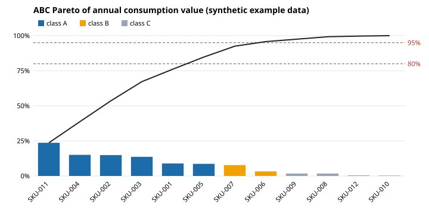
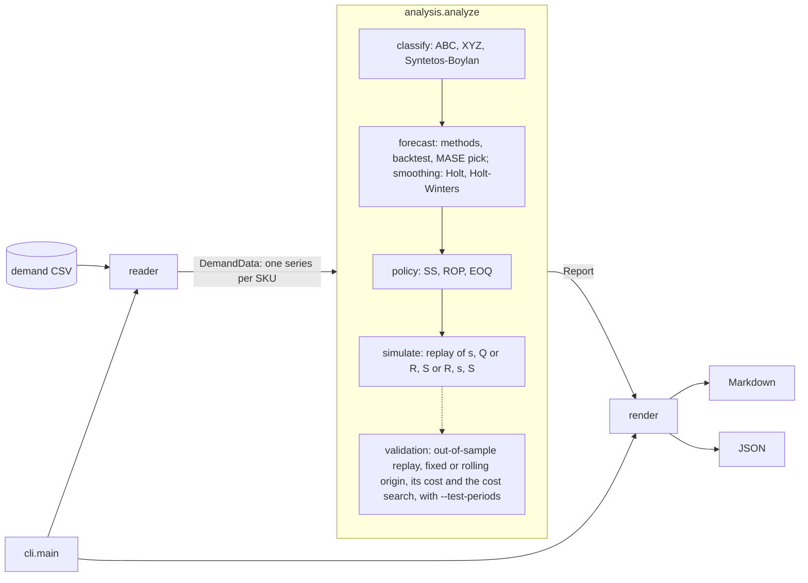

# inventory-policy-lab

[](https://github.com/rodrix91/inventory-policy-lab/actions/workflows/ci.yml)

Turn a CSV of demand history per SKU into an inventory-policy report you can check: ABC-XYZ classes, demand patterns (smooth, erratic, intermittent, lumpy), backtested forecasts (including damped Holt and Holt-Winters on request), safety stock, reorder point, EOQ, and a replay of the resulting (s, Q) policy on the same history. On request it replays a periodic-review, order-up-to (R, S) policy instead, with levels that can follow a seasonal forecast period by period.

Python 3.11+, standard library only at runtime. Library and command line.

**Status: alpha, version 0.10.0.** The methods are textbook methods, implemented and tested carefully, but the tool has not been used on many real datasets yet. Read [Limitations](#limitations) before using its numbers for real orders.

## Companion data-quality tools

Before using a demand extract for policy analysis:

- use [csv-quality-report](https://github.com/rodrix91/csv-quality-report) for deeper profiling, types, ranges, allowed values, uniqueness, freshness, schema changes, and baseline drift;
- use [ops-field-brief](https://github.com/rodrix91/ops-field-brief) for fast operational checks such as required-field fill, repeated business keys, minimum row counts, and counterparty concentration.

This keeps data validation separate from inventory-policy modeling and makes each step easier to audit.

## Why it matters for operations

Most stock problems are policy problems: the same safety-stock rule applied to a fast, stable item and to a spare part that sells twice a year; a forecast chosen because it is the default, not because it was tested; a reorder point computed once and never checked against what would actually have happened. This tool makes each step explicit and reviewable:

- **Segment before you set policy.** ABC (value) and XYZ (variability) tell you where accuracy and service matter most; the Syntetos-Boylan classes tell you which forecasting methods even make sense.
- **Test the forecast on data it has not seen.** Every candidate method is backtested on a holdout and scored with MASE, which works with zero-demand periods (MAPE does not). With `--trend-seasonal`, damped Holt and Holt-Winters compete too, with their parameters fitted only on the periods before each forecast.
- **Verify the policy, not only the formula.** The (s, Q) policy is replayed period by period on the history, reporting the fill rate, stockout periods and average stock it would have produced. When the normal-distribution formula does not fit the item (lumpy demand, seasonality), the replay shows it. With `--test-periods N` the policy is also fitted on the earlier periods only and replayed on the last N, out of sample. `--policy RS` replays a periodic-review, order-up-to policy, and `--dynamic-levels` lets the level follow a trend or seasonal forecast instead of staying fixed all year.

It was written for teaching and analysis in operations management and logistics: every number in the report can be traced to a formula below, and the [worked example](#worked-example-checked-by-hand) is verified by hand in the test suite.

## Install

Not on PyPI. Install from GitHub (or from a clone with `pip install .`):

```bash
python -m pip install "git+https://github.com/rodrix91/inventory-policy-lab@v0.10.0"
inventory-policy-lab --help
```

From a clone you can also run it without installing: `PYTHONPATH=src python -m inventory_policy_lab ...`.

## GitHub Action

The repository also exposes a composite GitHub Action for running the same inventory-policy analysis inside a workflow. It uses the CLI's own atomic `--output` path and does not add runtime dependencies.

The current `v0.10.0` release predates this Action. Until a future release includes it, `@main` follows Unreleased changes; pin a reviewed commit SHA when reproducibility matters.

```yaml
steps:
  - uses: actions/checkout@3d3c42e5aac5ba805825da76410c181273ba90b1 # v7

  - name: Build inventory policy report
    id: inventory
    uses: rodrix91/inventory-policy-lab@main
    with:
      path: data/demand.csv
      args: --holdout 6 --test-periods 6
      format: json
      report-path: reports/inventory-policy.json

  - name: Upload the report
    uses: actions/upload-artifact@ea165f8d65b6e75b540449e92b4886f43607fa02 # v4
    with:
      name: inventory-policy-report
      path: "${{ steps.inventory.outputs.report-path }}"
```

The Action returns the CLI result directly: a nonzero inventory-policy-lab exit code fails the step unless the caller uses `continue-on-error`.

| Output | Meaning |
|---|---|
| `exit-code` | CLI exit code (`0` success; `2` invalid option; `3` missing/unreadable input; `4` invalid data; `5` history too short) |
| `succeeded` | `true` only when the analysis completed with exit code `0` |
| `report-path` | Report file path on success; empty on failure |

Inputs:

| Input | Default | Meaning |
|---|---|---|
| `path` | required | Demand-history CSV relative to the caller workspace |
| `args` | `""` | Additional analytical CLI arguments, parsed as argv and never evaluated as shell code |
| `format` | `markdown` | `markdown` or `json` |
| `report-path` | `""` | Optional relative report path that must remain inside the workflow workspace; empty uses the runner temp directory |
| `python-version` | `3.12` | Python used by the Action |
| `summary` | `false` | Append the completed report to the GitHub job summary |

`--format`, `-o`, and `--output` are reserved by the Action and must use the dedicated inputs instead. The Action also rejects `-h`, `--help`, `--version`, and accepted long-option abbreviations such as `--ver`, `--for=json` and `--out=...` with `exit-code=2`, `succeeded=false`, and no report-path output. These informational CLI options can exit successfully without analyzing the CSV; in an Action with an existing report file that could otherwise create a false-green result. To view help or a version, run the standalone CLI. An explicit `report-path` must be relative and resolve inside `GITHUB_WORKSPACE`; absolute paths and `..` escapes are refused. **The Action's input `path` is also confined to the caller's `GITHUB_WORKSPACE`**: absolute paths, paths that escape using `..` or symlinks, stdin (`-`), and paths containing line breaks are rejected with `exit-code=2`, `succeeded=false`, and an empty `report-path`. Relative paths that resolve inside the workspace are supported, including nested folders. This is an input-boundary check, not a complete sandbox against untrusted code running in the job. The Action creates the report directory when needed, while the CLI still performs its existing atomic write and input/output collision checks.

## Verify release artifacts

Releases produced by the current release workflow include a `SHA256SUMS` file and GitHub artifact provenance attestations for the wheel and source distribution. After downloading the release files into one directory, verify the checksums:

```bash
sha256sum -c SHA256SUMS
```

Then verify provenance for each artifact with GitHub CLI:

```bash
gh attestation verify PATH/TO/ARTIFACT -R rodrix91/inventory-policy-lab
```

Historical releases created from older commits may predate checksums or provenance attestations; verify only the guarantees actually published with that release.

## Quickstart

The repository ships a **synthetic** dataset ([`examples/demand_synthetic.csv`](examples/demand_synthetic.csv)): 12 made-up SKUs over 24 months, generated with a fixed seed by [`scripts/generate_example.py`](scripts/generate_example.py). It is not real company data; it was built to contain each demand pattern, an item introduced late and a month without a row.

```bash
python -m inventory_policy_lab examples/demand_synthetic.csv
```

Output:

````markdown
# Inventory policy report

- Source: `examples/demand_synthetic.csv` (273 rows)
- SKUs: 12; periods: 24 (month), 2024-01 to 2025-12
- ABC by annual consumption value (units x unit cost): A < 80% and B < 95% of cumulative value; XYZ by CV: X <= 0.5, Y <= 1
- Target cycle service level: 95%; review period: 1; holdout: last 6 periods; safety-stock sigma: standard deviation of demand per period
- Replayed fill rate, all SKUs: 99.4%

## ABC-XYZ matrix

|  | X | Y | Z | Total |
|---|---|---|---|---|
| **A** | 5 | 1 | 0 | 6 |
| **B** | 0 | 0 | 2 | 2 |
| **C** | 1 | 0 | 3 | 4 |

## Demand patterns (Syntetos-Boylan)

| Pattern | SKUs |
|---|---|
| smooth | 6 |
| erratic | 1 |
| intermittent | 3 |
| lumpy | 2 |

## Policy per SKU

| SKU | Class | Pattern | Method | Forecast/period | CSL | Safety stock | Reorder point (s) | Order qty (Q) | Fill rate | Stockout periods | Avg on hand |
|---|---|---|---|---|---|---|---|---|---|---|---|
| SKU-001 | AX | smooth | moving_average | 119.7 | 95% | 103.1 | 372.3 | 119.7 (cover) | 100.0% | 0/24 | 190.8 |
| SKU-002 | AX | smooth | naive | 30.0 | 95% | 41.1 | 141.1 | 30.0 (cover) | 100.0% | 0/24 | 42.8 |
| SKU-003 | AX | smooth | naive | 68.0 | 95% | 63.1 | 199.1 | 68.0 (cover) | 98.0% | 3/24 | 76.5 |
| SKU-004 | AX | smooth | naive | 83.0 | 95% | 41.7 | 207.7 | 83.0 (cover) | 100.0% | 0/24 | 141.2 |
| SKU-005 | AY | erratic | naive | 152.0 | 95% | 296.2 | 714.2 | 152.0 (cover) | 100.0% | 0/24 | 555.7 |
| SKU-006 | BZ | intermittent | ses | 2.4 | 95% | 13.2 | 21.3 | 2.4 (cover) | 95.9% | 1/24 | 10.9 |
| SKU-007 | BZ | lumpy | ses | 3.6 | 95% | 40.7 | 57.6 | 3.6 (cover) | 100.0% | 0/24 | 40.6 |
| SKU-008 | CZ | intermittent | sba | 0.4 | 95% | 1.1 | 1.9 | 0.4 (cover) | 99.8% | 1/24 | 1.4 |
| SKU-009 | CX | smooth | ses | 126.0 | 95% | 25.2 | 277.2 | 126.0 (cover) | 100.0% | 0/24 | 113.8 |
| SKU-010 | CZ | intermittent | ses | 0.4 | 95% | 8.4 | 9.5 | 0.4 (cover) | 76.9% | 2/24 | 7.1 |
| SKU-011 | AX | smooth | ses | 40.3 | 95% | 17.0 | 137.9 | 40.3 (cover) | 100.0% | 0/10 | 54.1 |
| SKU-012 | CZ | lumpy | ses | 0.7 | 95% | 26.2 | 27.5 | 0.7 (cover) | 72.5% | 2/24 | 22.6 |

## Forecast backtest (MASE, last 6 periods)

Lower is better; below 1 beats the in-sample naive forecast. Intermittent and lumpy SKUs are scored with SES, Croston and SBA; the others with naive, moving average and SES.

| SKU | naive | moving_average | ses | croston | sba | Bias of pick |
|---|---|---|---|---|---|---|
| SKU-001 | 1.40 | **0.70** | 0.87 | - | - | -0.67 |
| SKU-002 | **0.30** | 0.41 | 0.41 | - | - | 2.67 |
| SKU-003 | **1.00** | 1.99 | 2.06 | - | - | 5.17 |
| SKU-004 | **1.67** | 2.17 | 2.76 | - | - | -2.33 |
| SKU-005 | **0.75** | 1.20 | 1.09 | - | - | -0.83 |
| SKU-006 | - | - | **0.91** | 0.97 | 0.95 | 1.54 |
| SKU-007 | - | - | **3.46** | 4.78 | 4.65 | -2.07 |
| SKU-008 | - | - | 0.83 | 0.85 | **0.83** | 0.24 |
| SKU-009 | 1.84 | 1.26 | **1.23** | - | - | -2.99 |
| SKU-010 | - | - | **0.33** | 0.43 | 0.41 | 1.04 |
| SKU-011 | 1.44 | 1.17 | **0.91** | - | - | -0.01 |
| SKU-012 | - | - | **0.12** | 0.88 | 0.84 | 1.06 |

## Notes

- SKU-002: 1 period(s) without rows counted as zero demand
- SKU-003: no observed lead times: default lead time used
- SKU-008: no observed lead times: default lead time used
- SKU-009: no observed lead times: default lead time used
- SKU-012: no observed lead times: default lead time used

Fill rate, stockout periods and average on hand come from replaying this same history under the (s, Q) policy (in-sample): a check of the formulas on the data, not a forecast of future service.
````

This is the real output of that command; the test suite fails if it drifts from a fresh run (`python scripts/update_readme_samples.py` regenerates it). Add `--format json` for every number, including all backtest metrics, z, sigmas, EOQ and the replay details, or `-o report.md` to write a file.

How to read it: the replayed fill rate is a different measure from the target **cycle** service level (the probability of not running out in a replenishment cycle), so they are not expected to match. In this run every smooth item reaches a fill rate of 98% or more. Two SKUs do not: the lumpy SKU-012 (about 73%) and the intermittent SKU-010 (about 77%). SKU-012's demand is mostly zero with occasional orders of 40 to 90 units, far from the normal distribution the safety-stock formula assumes, and a constant reorder point cannot protect it at 95%. That is the kind of finding the replay is there to surface.

The ABC Pareto of this dataset, drawn as SVG with the standard library by [`scripts/make_pareto_svg.py`](scripts/make_pareto_svg.py) from the same run:



## Input format

One row per SKU and period, long format. Header names are case-insensitive. **Ambiguous input columns are rejected:** when two headers refer to the same consumed field (for example, `quantity` alongside `qty` or `demand`, `period` alongside `date`, or `sku` repeated with different capitalization), the parser raises a data error (CLI exit `4`) instead of silently using one of them. The same rule applies to optional `unit_cost` and `lead_time`, and to `order_cost` / `stockout_cost` when `--cost-columns` is enabled. Unrelated extra columns remain untouched.

**CSV quoting is validated strictly:** unterminated quoted fields or unexpected text after a closing quote are rejected as data errors (CLI exit `4`) rather than silently changing a SKU or quantity. Valid quoted commas and multiline fields remain supported. Existing `--output` reports are preserved when validation fails.

**Markdown safety:** SKU identifiers from the CSV are displayed literally in inventory policy, forecast backtest, replay and cost tables, and in per-SKU notes. Pipes, Markdown links, HTML-like text and embedded line breaks cannot create misleading table cells or headings. The JSON report retains the exact original SKU string, and the analysis, forecasts and cost calculations are unchanged.

| Column | Required | Meaning |
|---|---|---|
| `sku` | yes | Item identifier |
| `period` or `date` | yes | `YYYY-MM`, `YYYY-MM-DD`, or an integer; one format per file |
| `quantity` (`qty`, `demand`) | yes | Demand in the period, a number >= 0 |
| `unit_cost` | no | Cost of one unit; the most recent non-empty value per SKU is used. Needed for ABC by value and for EOQ |
| `lead_time` | no | An observed replenishment lead time in periods. All non-empty values of a SKU are treated as observations (mean and standard deviation) |
| `order_cost`, `stockout_cost` | no | Read only with `--cost-columns`: the SKU's cost per order placed and per unit short, to price the out-of-sample replay; the most recent non-empty value per SKU is used ([ADR 0014](docs/decisions/0014-cost-rates-per-sku.md)) |

- Several rows for the same SKU and period are summed. If individually finite quantities overflow the numeric range when combined (for example, `1e308 + 1e308`), the CSV is rejected as a data error (exit `4`) rather than generating an infinite demand forecast; existing report files are preserved.
- A SKU's series starts at its first period in the file and ends at the file's last period. Periods in between without a row count as zero demand (the report notes how many). For months and integers the calendar is complete; for dates it is the set of dates present, since the frequency cannot be inferred.
- Integer periods are interpreted numerically: zero-padded labels (`01`, `002`) and equivalent representations (`-0` and `0`) share a canonical calendar period. Demand and observed lead-time dates use the same normalized period labels, so equivalent spellings aggregate rather than causing a calendar lookup error. Month and date formats are unchanged.
- Demand is what customers asked for. Net returns out before the analysis: negative quantities are rejected.

## Worked example (checked by hand)

[`examples/worked_example.csv`](examples/worked_example.csv) has two SKUs over 8 periods. Every number below is derived by hand in the docstring of [`tests/test_worked_example.py`](tests/test_worked_example.py), and the test asserts them. For W-1 (demand 10 12 8 10 14 6 10 14, unit cost 2, lead time 2):

- Moving average wins the holdout with MASE 0.5 (MAE 2 over a naive in-sample scale of 4), so the forecast is mean(6, 10, 14) = 10 per period.
- Safety stock = 1.6449 x sqrt((2 + 1) x 54/7) = 7.91; reorder point = 10 x (2 + 1) + 7.91 = 37.91.
- EOQ = sqrt(2 x 120 x 30 / (0.25 x 2)) = 120.

W-2 (0 0 6 0 0 0 9 0) is intermittent (ADI 4, CV² 0.04); SBA wins with forecast 0.95 x 6.3 / 3.1 = 1.93.

```bash
python -m inventory_policy_lab examples/worked_example.csv --holdout 2 --ordering-cost 30 --holding-rate 0.25
```

Output:

````markdown
# Inventory policy report

- Source: `examples/worked_example.csv` (16 rows)
- SKUs: 2; periods: 8 (integer), 1 to 8
- ABC by annual consumption value (units x unit cost): A < 80% and B < 95% of cumulative value; XYZ by CV: X <= 0.5, Y <= 1
- Target cycle service level: 95%; review period: 1; holdout: last 2 periods; safety-stock sigma: standard deviation of demand per period
- Replayed fill rate, all SKUs: 100.0%

## ABC-XYZ matrix

|  | X | Y | Z | Total |
|---|---|---|---|---|
| **A** | 1 | 0 | 0 | 1 |
| **B** | 0 | 0 | 1 | 1 |
| **C** | 0 | 0 | 0 | 0 |

## Demand patterns (Syntetos-Boylan)

| Pattern | SKUs |
|---|---|
| smooth | 1 |
| erratic | 0 |
| intermittent | 1 |
| lumpy | 0 |

## Policy per SKU

| SKU | Class | Pattern | Method | Forecast/period | CSL | Safety stock | Reorder point (s) | Order qty (Q) | Fill rate | Stockout periods | Avg on hand |
|---|---|---|---|---|---|---|---|---|---|---|---|
| W-1 | AX | smooth | moving_average | 10.0 | 95% | 7.9 | 37.9 | 120.0 (eoq) | 100.0% | 0/8 | 111.7 |
| W-2 | BZ | intermittent | sba | 1.9 | 95% | 8.3 | 12.1 | 74.6 (eoq) | 100.0% | 0/8 | 80.0 |

## Forecast backtest (MASE, last 2 periods)

Lower is better; below 1 beats the in-sample naive forecast. Intermittent and lumpy SKUs are scored with SES, Croston and SBA; the others with naive, moving average and SES.

| SKU | naive | moving_average | ses | croston | sba | Bias of pick |
|---|---|---|---|---|---|---|
| W-1 | 1.00 | **0.50** | 0.55 | - | - | -2.00 |
| W-2 | - | - | 2.22 | 1.88 | **1.88** | -2.58 |

## Notes

- W-2: no observed lead times: default lead time used

Fill rate, stockout periods and average on hand come from replaying this same history under the (s, Q) policy (in-sample): a check of the formulas on the data, not a forecast of future service.
````

## Python API

```python
from inventory_policy_lab import Config, analyze_file, render_markdown

config = Config(class_service_levels={"A": 0.98}, ordering_cost=40, holding_rate=0.25)
report = analyze_file("examples/demand_synthetic.csv", config)
for sku in report.skus:
    print(sku.sku, sku.abc_xyz, sku.method, sku.policy.reorder_point, sku.simulation.fill_rate)
markdown = render_markdown(report)  # or render_json(report) / report.to_dict()
```

The building blocks are public too: `read_demand`, `abc_classes`, `xyz_class`, `demand_profile`, `naive`, `moving_average`, `ses`, `croston`, `sba`, `backtest`, `safety_stock`, `bootstrap_safety_stock`, `eoq`, `build_policy`, `simulate` (with `warmup=` to replay periods without scoring them), `train_history`, `out_of_sample_replay`, and the trend and seasonal models `holt_damped`, `holt_winters`, `fit_holt_damped` and `fit_holt_winters` (which return a `SmoothingFit` with `forecast(h)` and the parameters picked; `fit_cache_info()` and `clear_fit_cache()` inspect and empty their cache). `Config(trend_seasonal=True, season_length=12)` adds those models to the candidates of smooth and erratic SKUs. `Config(test_periods=12)` adds the out-of-sample replay to the report as `report.out_of_sample` (an `OutOfSampleReport`, with `totals(method, "in_sample" | "out_of_sample")`). `Config(policy="RS", review_period=1)` replays an (R, S) policy (`simulate_periodic`) and `Config(policy="RsS", review_period=1)` an (R, s, S) policy (`simulate_rss`), and `Config(trend_seasonal=True, dynamic_levels=True)` gives each SKU one level per period (`SkuResult.levels`, `next_levels`; `PolicyReplay.test_levels` out of sample), built by `dynamic_levels` from `SmoothingFit.calendar_forecasts`; `replay_policy` replays any of them. `Config(bootstrap_source="residuals")` bootstraps forecast errors (`interval_forecast_errors`, `residual_bootstrap_quantile`), and with dynamic levels `period_safety_stock=True` gives each period its own safety stock (`period_safety_stocks`; `SkuResult.safety_stocks`, `next_safety_stocks`; `PolicyReplay.test_safety_stocks`). `Config(test_periods=12, rolling_origin=True)` also refits every SKU at each test period (`SkuOutOfSample.rolling`, one `RollingReplay` per safety-stock method, and `OutOfSampleReport.rolling_totals(method)`); `refit_every=3` refits every third test period only (`OutOfSampleReport.refit_every`). `Config(test_periods=12, order_cost=50, holding_cost=1, stockout_cost=20)` prices the test periods (`OutOfSampleReport.cost(method, "fixed" | "rolling")` and `sku_cost(sku, method, origin)` return a `CostBreakdown`; `replay_cost` and `total_cost` price any `SimulationResult` with `CostRates`). `holding_cost_rate=0.25` prices holding as a yearly share of each SKU's unit cost and `cost_columns=True` (with `read_demand(path, cost_columns=True)`, which `analyze_file` does for you) takes order and stockout costs per SKU from the file (`Config.sku_cost_rates(history)`, `OutOfSampleReport.rates_of(sku)`). `optimize_cost=True` adds a cost-optimised replay per SKU (`SkuOutOfSample.optimized`, an `OptimizedReplay`, importable from the package; `OutOfSampleReport.optimized_cost()`, `optimized_sku_cost(sku)`, `optimized_totals()`); `optimize_fill_floor=0.95` keeps only picks with that expected fill rate on the training paths (`CostSearch.expected_fill`, `fell_back`) and `optimize_paths="refit"` refits the forecast on bootstrapped training histories (`OptimizedReplay.paths`). `inventory_policy_lab.optimize` exposes the search (`search_levels`, `expected_costs`, `expected_outcomes`, `demand_paths`, `bootstrap_histories`). `simulate` accepts one order quantity per period. Errors are subclasses of `InventoryPolicyError` with an `exit_code`.

## Options

**Numeric safety:** policy durations, demand annualization, order coverage, EOQ rates and ABC-XYZ thresholds must be finite numbers. Inputs such as `--lead-time NaN`, `--periods-per-year inf` or `--xyz-thresholds 0.5,inf` fail with exit code `2` and do not replace an existing report. JSON and Markdown calculations with valid finite values are unchanged.

| Option | Default | Meaning |
|---|---|---|
| `--format markdown\|json` | markdown | Output format |
| `-o, --output FILE` | stdout | Write the report to a file |
| `--service-level P` | 0.95 | Target cycle service level, 0.5 <= P < 1 |
| `--class-service-levels A=0.99,B=0.95,C=0.9` | none | Service level per ABC class |
| `--lead-time L`, `--lead-time-std S` | 1, 0 | Lead time (periods) for SKUs without `lead_time` values |
| `--review-period R` | 1 | Periods between reviews, added to the protection interval; 0 = continuous review. A whole number of at least 1 with `--policy RS` or `RsS` |
| `--policy sQ\|RS\|RsS` | sQ | `sQ`: reorder point s and fixed order quantity Q, checked every period; `RS`: review every R periods and order up to S; `RsS`: review every R periods and order up to S = s + Q only when the position is at or below s; see [ADR 0007](docs/decisions/0007-periodic-review-and-dynamic-levels.md) and [ADR 0013](docs/decisions/0013-periodic-review-rss-policy.md) |
| `--dynamic-levels` | off | Let s or S follow the picked trend or seasonal forecast period by period instead of one level for the whole history; needs `--trend-seasonal` |
| `--ordering-cost S`, `--holding-rate h` | none | Cost per order and yearly holding cost as a fraction of unit cost; together they enable EOQ |
| `--order-cover K` | 1 | Without EOQ, order quantity = forecast x K periods |
| `--sigma demand\|rmse` | demand | Safety-stock sigma: standard deviation of demand per period, or RMSE of the picked forecast on the holdout |
| `--safety-stock normal\|bootstrap` | normal | Safety stock from the normal formula, or from a bootstrap of protection-interval demand |
| `--bootstrap-source demand\|residuals` | demand | What the bootstrap resamples: demand per period, or the rolling-origin errors of the picked forecast over the protection interval; applies to `--safety-stock bootstrap` and to the bootstrap replay of `--test-periods`; see [ADR 0008](docs/decisions/0008-residual-bootstrap-and-period-safety-stock.md) |
| `--period-safety-stock` | off | With `--dynamic-levels` and `--bootstrap-source residuals`: one safety stock per period, proportional to the forecast it protects (only for SKUs with a damped Holt or Holt-Winters forecast) |
| `--bootstrap-samples N`, `--seed S` | 2000, 0 | Draws per SKU (at least 100) and random seed of the bootstrap; the same seed gives the same report |
| `--test-periods N` | 0 (off) | Also fit normal and bootstrap policies on all but the last N periods and replay them out of sample on those N; the training window needs at least holdout + 2 periods |
| `--rolling-origin` | off | With `--test-periods`: also replay the test window refitting forecast, safety stock, level and order quantity at the start of every test period from the periods before it, next to the fixed-origin replay; see [ADR 0009](docs/decisions/0009-rolling-origin-replay.md) |
| `--refit-every K` | 1 | With `--rolling-origin`: refit only at the start of every K-th test period (the first, then every K) and keep that refit's safety stock, order quantity and, with dynamic levels, its forecasts 1 to K steps ahead until the next; 1 is the monthly refit, K at least `--test-periods` gives the fixed origin; see [ADR 0011](docs/decisions/0011-refit-every-k-periods.md) |
| `--order-cost C`, `--holding-cost C`, `--stockout-cost C` | none | With `--test-periods`: price every replay of the test periods: C per order placed, per unit on hand at the end of a period (per period), and per unit of demand not served from stock in its period; a cost left out is 0 once another is given. Adds a cost section (totals and per SKU) to the report and does not change the policy; see [ADR 0012](docs/decisions/0012-cost-of-the-out-of-sample-replay.md) |
| `--holding-cost-rate RATE` | none | Instead of `--holding-cost`: yearly holding cost as a fraction of each SKU's `unit_cost` (needs the column), so a unit held one period costs RATE x unit_cost / `--periods-per-year`; separate from the EOQ `--holding-rate`; see [ADR 0014](docs/decisions/0014-cost-rates-per-sku.md) |
| `--cost-columns` | off | Take each SKU's cost per order and per unit short from the optional `order_cost` and `stockout_cost` columns; a SKU without a value uses `--order-cost` / `--stockout-cost` |
| `--optimize-cost` | off | With cost rates and `--policy sQ` or `RsS`: also pick each SKU's safety stock and order quantity (so `s` and `S = s + Q`) on a bounded grid for the lowest expected cost of the test window, estimated on demand paths built from the training periods only, and replay that policy on the test (fixed origin); see [ADR 0015](docs/decisions/0015-cost-optimised-levels.md) |
| `--optimize-samples N` | 100 | Demand paths per SKU of that search (at least 10) |
| `--optimize-fill-floor F` | off | With `--optimize-cost`: accept only pairs whose expected fill rate on the training paths is at least `F` (in (0, 1]); a SKU where none qualifies keeps the heuristic pair; see [ADR 0016](docs/decisions/0016-fill-rate-floor-for-the-cost-search.md) |
| `--optimize-paths KIND` | `forecast` | With `--optimize-cost`: `forecast` scores on the training forecast plus resampled errors; `refit` rebuilds each path's training history with a block bootstrap of the one-step errors and refits the forecast on it, so the paths carry the model's own uncertainty; see [ADR 0017](docs/decisions/0017-refit-demand-paths.md) |
| `--trend-seasonal` | off | Also backtest damped Holt and Holt-Winters (additive, multiplicative) on smooth and erratic SKUs when the history allows; see [ADR 0006](docs/decisions/0006-trend-and-seasonal-forecasts.md) |
| `--season-length M` | `--periods-per-year` | Season of Holt-Winters in periods (12 for months); only with `--trend-seasonal` |
| `--abc-thresholds a,b` | 0.8,0.95 | Cumulative value shares that end classes A and B |
| `--xyz-thresholds x,y` | 0.5,1.0 | CV limits of X and Y |
| `--periods-per-year N` | 12 | To annualize demand (52 for weeks) |
| `--holdout H` | 6 | Periods held out for the backtest |
| `--ma-window W`, `--ses-alpha a`, `--croston-alpha a` | 3, 0.2, 0.1 | Method parameters |

Exit codes: `0` report written, `2` invalid option or value, `3` input file missing, unreadable or not UTF-8 (including permission, metadata-inspection or I/O errors; previously written output is preserved), `4` invalid data, `5` history too short for the holdout (needs at least holdout + 2 periods, in the training window with `--test-periods`).

## Methods

All demand quantities are per period; lead times are in periods.

**ABC.** Annual consumption value = mean demand per period x periods per year x unit cost (annual units when there is no `unit_cost` column). Items are sorted by value; an item is A while the cumulative share of the items *before* it is below 80%, B while it is below 95%, C after that. Testing the share before the item keeps the largest item in A even when it alone exceeds 80%.

**XYZ.** `CV = population standard deviation / mean` of demand per period: X if CV <= 0.5, Y if CV <= 1.0, else Z (also Z when there is no demand). Cut-offs vary in practice; both sets of thresholds are options.

**Demand pattern** (Syntetos, Boylan & Croston, 2005). `ADI = periods / periods with demand`; `CV² = (population sd / mean)²` of the non-zero demand sizes. Smooth: ADI < 1.32 and CV² < 0.49; erratic: ADI < 1.32 and CV² >= 0.49; intermittent: ADI >= 1.32 and CV² < 0.49; lumpy: both above.

**Forecasts** (one step ahead):

```
naive:            F(t+1) = y(t)
moving average:   F(t+1) = mean(y(t-W+1) .. y(t))
SES:              L(t) = L(t-1) + a (y(t) - L(t-1)),  L(1) = y(1),  F(t+1) = L(t)
Croston:          size z and interval p smoothed only when demand occurs,
                  starting at the first demand; F = z / p
SBA:              F = (1 - a/2) z / p          (Syntetos & Boylan, 2005)
```

With `--trend-seasonal`, smooth and erratic SKUs also get (Gardner & McKenzie, 1985; Winters, 1960; Hyndman & Athanasopoulos, 2021):

```
damped Holt:      F(t+h) = L(t) + (phi + ... + phi^h) B(t)
                  L(t) = a y(t) + (1 - a)(L(t-1) + phi B(t-1))
                  B(t) = b (L(t) - L(t-1)) + (1 - b) phi B(t-1)
                  start: L(2) = y(2), B(2) = y(2) - y(1)
Holt-Winters:     F(t+h) = L(t) + (phi + ... + phi^h) B(t) + S(t+h-m)    (multiplicative: x S)
                  L(t) = a (y(t) - S(t-m)) + (1 - a)(L(t-1) + phi B(t-1))
                  S(t) = g (y(t) - L(t)) + (1 - g) S(t-m),  B(t) as above
                  start: L = mean of season 1, B = (mean of season 2 - mean of season 1) / m,
                  S(i) = y(i) - L (multiplicative: y(i) / L)
```

The parameters are picked by a grid search (a 0.1 to 0.9; b, g in {0.05, 0.1, 0.2, 0.3}; phi in {0.8, 0.9, 0.95, 0.98}) minimising the squared one-step errors of the history passed in, so at each backtest origin, and in the training window of `--test-periods`, later periods cannot influence them. Damped Holt needs 4 periods before the first holdout origin, Holt-Winters two full seasons (`2 x m`, with `m = --season-length`, by default `--periods-per-year`), the multiplicative form demand in every period; otherwise the model is not a candidate. Forecasts are floored at zero. Fits are cached by exact history, and a new history is scored once per parameter set over all its prefixes, which gives the same fits as a grid search per prefix, bit for bit, at the cost of one ([ADR 0010](docs/decisions/0010-fit-cache-and-prefix-grid.md)). When one of these models is picked, the forecast used by the policy is its mean over the next `L + R` periods (rounded half up), because the reorder point protects that interval and the policy is static.

Smooth and erratic SKUs are scored with naive, moving average and SES (plus the models above with `--trend-seasonal`, after them in the tie-break order); intermittent and lumpy SKUs with SES, Croston and SBA. Naive and moving averages are left out on mostly-zero series because after a run of zeros they forecast zero, which scores well on error measures yet means holding no stock (Teunter & Duncan, 2009); see [ADR 0002](docs/decisions/0002-forecast-selection.md).

**Backtest and selection.** For each of the last H periods, the method is fitted on the periods before it and forecasts that period (rolling origin). With errors `e = forecast - actual`:

```
MAE  = mean |e|          RMSE = sqrt(mean e²)          bias = mean e   (positive = over-forecast)
MASE = MAE / mean |y(i) - y(i-1)| over the training periods       (Hyndman & Koehler, 2006)
```

The method with the lowest MASE is used (ties go to the earlier method in the list above). MASE is undefined when the training data is constant; then MAE decides. MAPE is not used because it divides by actual demand, which is often zero. SKUs shorter than H + 2 periods are not backtested; they use a moving average (SES if intermittent) and the report says so.

**Safety stock and reorder point** (Silver, Pyke & Thomas, 2017), for a target cycle service level P:

```
z  = NormalDist().inv_cdf(P)
SS = z x sqrt((L + R) x sigma_D² + D² x sigma_L²)
s  = D x (L + R) + SS
```

`D` is the forecast per period, `sigma_D` the sample standard deviation of demand per period (or the holdout RMSE with `--sigma rmse`), `L` and `sigma_L` the mean and sample standard deviation of the observed lead times (or the defaults), and `R` the review period. Demand is reviewed once per period in the data, so `R = 1` by default: an order placed now must cover demand until the next order can arrive, `L + R` periods later. `R = 0` gives the continuous-review textbook formula. See [ADR 0003](docs/decisions/0003-policy-and-replay.md).

**Bootstrap safety stock** (`--safety-stock bootstrap`). Instead of assuming normal demand, each SKU draws N protection intervals: the length is a lead time drawn from the SKU's observed lead times (or the default `L`) plus `R`, rounded half up to whole periods, and the demand is the sum of that many periods drawn with replacement from the SKU's own history. The quantile P of those sums (nearest rank) is the stock that covered the interval in a share P of the draws:

```
Q_P = quantile P of the N bootstrap sums of protection-interval demand
SS  = max(Q_P - D x (L + R), 0)
s   = D x (L + R) + SS
```

The floor at zero keeps `s` from falling below the forecast over the interval (the report notes when it applies). Each SKU has its own generator seeded with `"<seed>:<sku>"`, so a SKU's result does not change when other SKUs are added to the file. Periods are drawn independently, so autocorrelation and trend are not kept; see [ADR 0004](docs/decisions/0004-bootstrap-safety-stock.md).

**Bootstrap of forecast residuals** (`--bootstrap-source residuals`). Instead of demand, the bootstrap resamples the errors of the picked forecast over the protection interval, so a trend or a season that the forecast follows is not counted as uncertainty. With `P = L + R` rounded half up, at every origin `t` from 2 to `n - P` the method is refitted on the periods before `t` only (Holt and Holt-Winters re-run their grid search; origins where a model cannot be fitted yet are skipped):

```
F_P(t) = forecast of the total demand of periods t .. t + P - 1, from periods 0 .. t - 1
e_P(t) = (y(t) + ... + y(t + P - 1)) - F_P(t)
SS     = max(quantile P of N draws of e, 0)       (each draw: a lead time, then one e of that length)
s      = D x (L + R) + SS
```

With too little history for any error, the SKU uses the demand bootstrap and the report says so; it also lists how many errors each SKU used. In the out-of-sample replay the errors come from the training periods only. See [ADR 0008](docs/decisions/0008-residual-bootstrap-and-period-safety-stock.md) (Trapero, Cardós & Kourentzes, 2019, for empirical safety stocks from lead-time forecast errors).

**EOQ.** `Q* = sqrt(2 x A x S / H)` with `A = D x periods per year`, `S` the cost per order and `H = holding rate x unit cost`. Without EOQ settings, `Q = D x order cover`; with a zero forecast, Q = 1 unit so the replay can run (noted in the report).

**Periodic review, order-up-to (R, S)** (`--policy RS`). The position is reviewed every `R` periods and an order brings it back up to `S`; the order must cover the `L + R` periods until the next review's order arrives, so `S` has the reorder-point formula and the same safety stock (Silver, Pyke & Thomas, 2017):

```
S = D x (L + R) + SS          order at a review = max(S - inventory position, 0)
```

**Periodic review (R, s, S)** (`--policy RsS`). The position is reviewed every `R` periods, and an order brings it up to `S` only when it has fallen to `s` or below, so a review with little demand places no order (Silver, Pyke & Thomas, 2017). `s` has the same formula and safety stock as the other two policies, and `S` adds one order quantity, the usual simple choice for (s, S) systems (not a cost optimisation):

```
s = D x (L + R) + SS          S = s + Q          order at a review = S - position, only if position <= s
```

**Dynamic levels** (`--dynamic-levels`, with `--trend-seasonal`). Instead of one level, each period gets its own, from the forecast of the periods it protects:

```
P    = L + R rounded half up (at least 1)
D(t) = mean of the forecasts of periods t + 1 .. t + P
s(t) or S(t) = D(t) x (L + R) + SS
```

A constant forecast gives exactly the static level. Periods after the fitted history get the model's real forecast `h` steps ahead; in the out-of-sample replay that fit uses the training periods only. Periods inside the fitted history (the in-sample replay) get the forecast of the same season position at the final level and trend, the way the static replay applies the final level to the whole history. The safety stock stays static unless `--period-safety-stock` is given. See [ADR 0007](docs/decisions/0007-periodic-review-and-dynamic-levels.md).

**Safety stock per period** (`--period-safety-stock`, with `--dynamic-levels` and `--bootstrap-source residuals`). The residual errors are taken relative to their forecast, `r_P(t) = e_P(t) / F_P(t)` (origins with a zero forecast skipped), and each period gets its own safety stock:

```
q        = quantile P of N draws of r
SS(t)    = max(q, 0) x D(t) x (L + R)
s(t), S(t) = D(t) x (L + R) + SS(t)
```

A peak month gets more safety stock than a trough, and the seasonal swing, which the levels already follow, is not counted again. SKUs with a level forecast keep one safety stock (every `D(t)` is the same) and the report notes it.

**Replay.** Starting with `s + Q` on hand: orders due arrive at the start of each period; demand is served from stock and the rest is backordered; at the end of the period, while the inventory position (net stock + on order) is at or below `s`, an order of `Q` is placed, arriving at the start of period `t + L + 1` (L rounded half up to whole periods). With `--policy RS` the run starts with `S` on hand, the position is reviewed only at the end of periods `R - 1, 2R - 1, ...`, and an order of `S - position` is placed when the position is below `S`, with the same arrival timing. With `--policy RsS` the run starts with `s + Q` on hand, the position is reviewed at the same periods, and an order of `s + Q - position` is placed only when the position is at or below `s`. With dynamic levels the level of each period replaces the fixed one. Fill rate = units served from stock when demanded / total demand; a stockout period is one whose demand was not fully served from stock; average on hand is the mean end-of-period stock.

**Cost of the out-of-sample replay** (`--order-cost`, `--holding-cost`, `--stockout-cost`, with `--test-periods`). Each replay of the test periods, fixed and rolling origin, normal and bootstrap, is priced from what it did in those periods, with the same rates for every SKU (a rate left out is 0):

```
cost = order cost x orders placed
     + holding cost x sum of end-of-period stock on hand          (= average on hand x periods)
     + stockout cost x units of demand not served from stock in their period
```

The stockout part is a cost per unit short (Silver, Pyke & Thomas, 2017), which matches the fill rate: units short = test demand x (1 - fill rate). The rates do not change the policy; the EOQ inputs `--ordering-cost` and `--holding-rate` do, and are separate. See [ADR 0012](docs/decisions/0012-cost-of-the-out-of-sample-replay.md).

## Bootstrap safety stock on the example

The same synthetic file with `--safety-stock bootstrap` (2000 draws, seed 0), against the default normal formula. Numbers from real runs, pinned in `tests/test_analysis.py`:

| SKU | Pattern | Fill rate, normal | Fill rate, bootstrap | Avg on hand, normal | Avg on hand, bootstrap |
|---|---|---|---|---|---|
| SKU-005 | erratic | 100.0% | 100.0% | 555.7 | 314.5 |
| SKU-006 | intermittent | 95.9% | 100.0% | 10.9 | 16.5 |
| SKU-010 | intermittent | 76.9% | 78.4% | 7.1 | 7.7 |
| SKU-012 | lumpy | 72.5% | 100.0% | 22.6 | 33.1 |
| All 12 SKUs | | 99.4% | 99.8% | 1,257.5 (sum) | 1,065.4 (sum) |

The lumpy SKU-012 goes from 72.5% to 100%, and the erratic SKU-005 keeps 100% with 43% less stock, because a few large months inflate its standard deviation far more than its 95% quantile. SKU-010 barely moves: one or two large orders in 24 months are too rare for any 95% quantile of single months to cover. **Caveat:** this replay is in-sample. The bootstrap resamples the same history the replay runs on, which flatters it; the [out-of-sample replay](#out-of-sample-replay-on-the-example) below shows how much of the advantage is left on periods the fit has not seen.

## Out-of-sample replay on the example

`--test-periods N` splits the calendar in time: every SKU is fitted on all but the last N periods (ABC on the training demand, demand pattern, forecast backtest and pick, sigma, the lead times observed in training, and the bootstrap draws), and both the normal and the bootstrap policy are replayed over the whole history. The training periods are scored as the in-sample result; the last N are scored as the out-of-sample result, starting from the stock and open orders the policy left at the end of training. See [ADR 0005](docs/decisions/0005-out-of-sample-replay.md).

```bash
python -m inventory_policy_lab examples/demand_synthetic.csv --test-periods 12
```

This adds an "Out-of-sample replay" section to the report (and an `out_of_sample` key to the JSON). With 12 test periods the example trains on 2024-01 to 2024-12 and tests on 2025-01 to 2025-12; SKU-011 starts in 2025-03 and is skipped. Numbers from real runs, pinned in `tests/test_validation.py`:

| Safety stock | Fill rate, full history (in-sample, ADR 0004) | Fill rate, train (in-sample) | Fill rate, test (out-of-sample) | Stockout periods, train / test | Avg on hand (sum), train / test |
|---|---|---|---|---|---|
| normal | 99.4% | 98.8% | 94.4% | 4 / 11 | 1,042.4 / 885.2 |
| bootstrap | 99.8% | 99.9% | 94.6% | 1 / 12 | 864.4 / 712.4 |

The full-history column covers all 12 SKUs and 24 periods; the other columns cover the 11 SKUs with training history. Out of sample both methods fall below 95%, and the bootstrap's in-sample lead almost disappears: 94.6% against 94.4%, with one stockout period more, although it holds about 20% less stock. Most of the loss comes from two items a level forecast cannot follow: the trending SKU-004 (79.7% normal, 67.7% bootstrap) and the seasonal SKU-003 (82.9% normal, 94.4% bootstrap). The intermittent SKU-008 is the clearest gain for the bootstrap (85.9% to 100%). One 12-period test window is a small sample, so read these as an indication, not a verdict on either method; the normal formula stays the default.

## Trend and seasonal forecasts on the example

`--trend-seasonal` adds damped Holt and Holt-Winters to the candidates ([ADR 0006](docs/decisions/0006-trend-and-seasonal-forecasts.md)). On the same synthetic file with `--test-periods 12`, before (0.2.0 candidates) and after:

```bash
python -m inventory_policy_lab examples/demand_synthetic.csv --test-periods 12 --trend-seasonal
```

| Scope | Safety stock | Fill rate train, before / after | Fill rate test, before / after | Stockout periods train / test, before / after | Avg on hand train / test, before / after |
|---|---|---|---|---|---|
| SKU-003 (seasonal) | normal | 92.3% / 92.3% | 82.9% / 82.9% | 3 / 4, 3 / 4 | 68.5 / 51.0, 68.5 / 51.0 |
| SKU-003 (seasonal) | bootstrap | 99.5% / 99.5% | 94.4% / 94.4% | 1 / 3, 1 / 3 | 100.6 / 79.2, 100.6 / 79.2 |
| SKU-004 (trend) | normal | 100.0% / 100.0% | 79.7% / 79.7% | 0 / 6, 0 / 6 | 60.7 / 8.6, 60.7 / 8.6 |
| SKU-004 (trend) | bootstrap | 100.0% / 100.0% | 67.7% / 67.7% | 0 / 9, 0 / 9 | 46.8 / 3.6, 46.8 / 3.6 |
| All 11 SKUs | normal | 98.8% / 98.8% | 94.4% / 94.4% | 4 / 11, 4 / 11 | 1,042.4 / 885.2, same |
| All 11 SKUs | bootstrap | 99.9% / 99.9% | 94.6% / 94.6% | 1 / 12, 1 / 12 | 864.4 / 712.4, same |

**On this file the new models change nothing out of sample**, and the reason is the data, not a bug: with 12 training months and a holdout of 6, the shortest fit has 6 periods, far from the 24 Holt-Winters needs for two seasons, so the seasonal SKU-003 never gets a seasonal candidate. Damped Holt is a candidate, but on SKU-004 it loses the training holdout (MASE 1.25 against 0.91 for the moving average), because 2024 demand is almost flat from July to November. On the full 24 months the main report does change: damped Holt wins the holdout of SKU-003 (MASE 0.90 against 1.00 for naive; in-sample fill rate 98.0% to 98.8%) and of SKU-009, and the replayed fill rate of all SKUs goes from 99.4% to 99.5%. SKU-004 keeps naive there too.

With enough history the models do get picked. On a 48-month synthetic series with known trend and seasonality (`trend_seasonal_series()` in [`tests/test_smoothing.py`](tests/test_smoothing.py), 36 training and 12 test months), the seasonal items pick additive and multiplicative Holt-Winters, and out of sample:

| Safety stock | Fill rate test, before / after | Stockout periods test, before / after | Avg on hand test (sum), before / after |
|---|---|---|---|
| normal | 97.5% / 99.6% | 3 / 1 | 189.8 / 289.0 |
| bootstrap | 96.6% / 97.6% | 5 / 4 | 172.4 / 196.4 |

Service improves, but mostly by holding more stock (52% more with the normal formula): the policy is static, so a seasonal forecast can only raise the one reorder point it sets for the whole year. The trending item keeps naive there as well. All numbers above are from real runs, pinned in `tests/test_smoothing.py`. The next section lets the level follow the season instead.

## Periodic review and dynamic levels

`--policy RS` replays a periodic-review, order-up-to policy, and `--dynamic-levels` lets the level follow the forecast period by period ([ADR 0007](docs/decisions/0007-periodic-review-and-dynamic-levels.md)). All numbers below are out of sample (the 12 test periods only), from real runs, pinned in [`tests/test_periodic.py`](tests/test_periodic.py). Average stock is summed over the SKUs; normal and bootstrap are the safety-stock methods, with the default sigma unless stated.

On the 48-month series of the previous section (36 training months, so Holt-Winters is picked for the seasonal items):

| Policy | Fill rate test, normal / bootstrap | Stockout periods test, normal / bootstrap | Avg on hand test, normal / bootstrap |
|---|---|---|---|
| (s, Q), level forecasts only (0.2.0) | 97.5% / 96.6% | 3 / 5 | 189.8 / 172.4 |
| (s, Q) static, `--trend-seasonal` (0.3.0) | 99.6% / 97.6% | 1 / 4 | 289.0 / 196.4 |
| (s, Q) dynamic | 100.0% / 98.8% | 0 / 2 | 269.9 / 174.8 |
| (R, S) static, R = 1 | 97.4% / 85.5% | 4 / 19 | 140.0 / 79.4 |
| (R, S) dynamic, R = 1 | 100.0% / 89.3% | 0 / 22 | 105.5 / 41.0 |
| (R, S) static, R = 3 | 99.6% / 92.4% | 2 / 7 | 589.1 / 389.3 |
| (R, S) dynamic, R = 3 | 99.9% / 90.4% | 1 / 10 | 439.3 / 247.0 |
| (R, S) dynamic, R = 1, `--sigma rmse` | 89.2% / 89.3% | 21 / 22 | 14.3 / 41.0 |

With the normal safety stock, (R, S) with dynamic levels reaches 100% fill rate and no stockout period with 105.5 units of average stock, 63% less than the static (s, Q) with Holt-Winters (289.0) and 44% less than the 0.2.0 policy. Part of that is the policy type: (s, Q) carries about `Q / 2` of cycle stock above its reorder point, which (R, S) with R = 1 does not. The dynamic levels alone, for the same policy, raise service and cut stock by about a quarter for (R, S) (140.0 to 105.5 with R = 1, 589.1 to 439.3 with R = 3) and by 7% for (s, Q).

Two results go the other way. The **bootstrap** loses service with (R, S): on the trending item, whose forecast is naive, the bootstrap quantile of a rising history is below the forecast over the interval, the safety stock is floored at zero, and that item reaches only 78.4% with 12 stockout periods; the cycle stock of (s, Q) used to hide it. And **`--sigma rmse`**, which in theory pairs better with levels that already carry the season, gives 89.2%: the RMSE of a 6-period holdout is too small a sample for a 95% safety stock.

On the 24-month synthetic example (`--test-periods 12`):

```bash
python -m inventory_policy_lab examples/demand_synthetic.csv --test-periods 12 --trend-seasonal --policy RS --dynamic-levels
```

| Policy | Fill rate test, normal / bootstrap | Stockout periods test, normal / bootstrap | Avg on hand test, normal / bootstrap |
|---|---|---|---|
| (s, Q) static (with or without `--trend-seasonal`) | 94.4% / 94.6% | 11 / 12 | 885.2 / 712.4 |
| (R, S) static or dynamic, R = 1 | 90.9% / 90.7% | 20 / 17 | 598.6 / 427.9 |
| (R, S) static or dynamic, R = 3 | 93.4% / 94.2% | 11 / 11 | 1,306.6 / 1,032.1 |

**Here the dynamic levels change nothing**: with 12 training months no SKU gets a seasonal model, every pick is a level method, and a level forecast gives the static level (the report notes it per SKU). (R, S) with R = 1 holds 32% less stock than (s, Q) but loses 3.5 points of fill rate; R = 3 nearly matches (s, Q) service with about 48% more stock. Which policy is better depends on what an order and a unit of stock cost, which this comparison does not price.

## Bootstrap of forecast residuals and safety stock per period

`--bootstrap-source residuals` and `--period-safety-stock` address the two weaknesses that 0.4.0 left documented ([ADR 0008](docs/decisions/0008-residual-bootstrap-and-period-safety-stock.md)): the demand bootstrap gave the trending item no safety stock, and the static safety stock counted the season twice once the levels followed it. All numbers are out of sample (the 12 test periods only), from real runs, pinned in [`tests/test_residuals.py`](tests/test_residuals.py). Each cell is fill rate / stockout periods / average stock on hand summed over the SKUs. "Normal" and "bootstrap demand" are the 0.4.0 methods, unchanged; the per-period column applies only with dynamic levels.

On the 48-month series (36 training months):

| Policy | Normal | Bootstrap demand (before) | Bootstrap residuals | Residuals + SS per period |
|---|---|---|---|---|
| (s, Q) static, `--trend-seasonal` | 99.6% / 1 / 289.0 | 97.6% / 4 / 196.4 | 98.4% / 3 / 185.5 | n/a |
| (s, Q) dynamic | 100.0% / 0 / 269.9 | 98.8% / 2 / 174.8 | 99.8% / 1 / 163.4 | 99.8% / 1 / 159.0 |
| (R, S) dynamic, R = 1 | 100.0% / 0 / 105.5 | 89.3% / 22 / 41.0 | 95.4% / 18 / 13.1 | 96.3% / 16 / 14.6 |
| (R, S) dynamic, R = 3 | 99.9% / 1 / 439.3 | 90.4% / 10 / 247.0 | 97.2% / 7 / 316.9 | 97.3% / 6 / 315.9 |

The bootstrap improves in every policy, by 6 to 7 points of fill rate under (R, S). The trending item T, which had a safety stock of 0 and 78.4% fill rate with 12 stockout periods under (R, S) R = 1, now gets 22.0 units from 33 forecast errors and reaches 93.3% with 6. The safety stock per period helps most on the trend-times-season item TS (91.7% with the demand bootstrap, 96.3% with residuals, 98.8% per period, its safety stock ranging from 19.4 to 35.5 units over the test year). **It does not catch up with the normal formula**, which still reaches 100% under (R, S) R = 1: the seasonal items have only 11 errors each (Holt-Winters can be refitted only from month 24), and the seasonal item S, which the demand bootstrap protected with 44 units at 100%, gets 6.6 units and 97.0%.

On the 24-month synthetic example (12 training months):

```bash
python -m inventory_policy_lab examples/demand_synthetic.csv --test-periods 12 --bootstrap-source residuals
```

| Policy | Normal | Bootstrap demand (before) | Bootstrap residuals | Residuals + SS per period |
|---|---|---|---|---|
| (s, Q) static | 94.4% / 11 / 885.2 | 94.6% / 12 / 712.4 | 92.2% / 15 / 975.8 | n/a |
| (s, Q) dynamic | 94.4% / 11 / 885.2 | 94.6% / 12 / 712.4 | 92.2% / 15 / 975.8 | 92.2% / 15 / 975.8 |
| (R, S) dynamic, R = 1 | 90.9% / 20 / 598.6 | 90.7% / 17 / 427.9 | 88.5% / 23 / 690.9 | 88.5% / 23 / 690.9 |
| (R, S) dynamic, R = 3 | 93.4% / 11 / 1,306.6 | 94.2% / 11 / 1,032.1 | 92.9% / 15 / 1,612.7 | 92.9% / 15 / 1,612.7 |

**Here the residual bootstrap is worse in every policy**: lower fill rate, more stockout periods and more stock. Twelve training months give each SKU only 6 to 9 errors, some from forecasts fitted on 2 periods; the erratic SKU-005 gets a much larger safety stock, the lumpy SKU-007 a quantile below zero, and the seasonal SKU-003 falls from 94.4% to 69.8%. Only the trending SKU-004 improves (67.7% to 82.0%). No SKU gets a seasonal model in 12 months, so the safety stock per period changes nothing. That is why the demand bootstrap stays the default: the residual bootstrap needs a few years of history to pay off.

## Rolling-origin replay

`--test-periods` keeps the policy fitted at the end of training for the whole test window, which is pessimistic for an operation that recomputes its policy every period. `--rolling-origin` adds a second replay of the test window ([ADR 0009](docs/decisions/0009-rolling-origin-replay.md)): at the start of every test period each SKU is refitted on the periods before it only (training plus the test periods already observed), with the same steps as on train (class, pattern, forecast pick, sigma, lead times, bootstrap draws, safety stock, level and order quantity), and that refit decides the end of the period. Both replays enter the test from the same stock and share the first decision, and a later test period can never change an earlier decision (tested by zeroing the last 8 months of the 48-month series). The numbers below are out of sample, from real runs pinned in [`tests/test_rolling.py`](tests/test_rolling.py); each cell is fill rate / stockout periods / average stock on hand summed over the SKUs.

```bash
python -m inventory_policy_lab examples/demand_synthetic.csv --test-periods 12 --trend-seasonal --bootstrap-source residuals --rolling-origin
```

On the 48-month series (36 training months):

| Policy | Normal, fixed origin | Normal, rolling origin | Bootstrap residuals, fixed | Bootstrap residuals, rolling |
|---|---|---|---|---|
| (s, Q) static, `--trend-seasonal` | 99.6% / 1 / 289.0 | 100.0% / 0 / 321.6 | 98.4% / 3 / 185.5 | 99.6% / 1 / 220.9 |
| (R, S) dynamic, R = 1 | 100.0% / 0 / 105.5 | 100.0% / 0 / 149.3 | 95.4% / 18 / 13.1 | 99.4% / 4 / 36.4 |

On the 24-month synthetic example (12 training months, the command above; add `--policy RS --dynamic-levels` for the second row):

| Policy | Normal, fixed origin | Normal, rolling origin | Bootstrap residuals, fixed | Bootstrap residuals, rolling |
|---|---|---|---|---|
| (s, Q) static, `--trend-seasonal` | 94.4% / 11 / 885.2 | 99.8% / 4 / 932.4 | 92.2% / 15 / 975.8 | 98.5% / 9 / 913.7 |
| (R, S) dynamic, R = 1 | 90.9% / 20 / 598.6 | 97.3% / 10 / 627.5 | 88.5% / 23 / 690.9 | 96.0% / 14 / 678.2 |

The rolling origin raises the fill rate and cuts stockout periods in every cell, but it is not free everywhere. **On the 24-month example the gain is large and cheap**: 5 to 8 points of fill rate, with about 5% more stock for the normal formula and 2% to 6% less for the residual bootstrap, which gains errors at every refit. It comes from the trending SKU-004 (normal (s, Q): 79.7% to 99.4%) and the seasonal SKU-003 (82.9% to 99.8%), whose forecasts the fixed policy froze for a year; the lumpy SKU-007 and the intermittent SKU-006 do not improve. **On the 48-month series it mostly buys stock**: where the fixed origin already served 100% (normal, (R, S) R = 1) the rolling origin keeps 100% with 42% more stock, because the demand sigma recomputed on a longer trending history grows (item T: 50.8 to 63.1 units of safety stock over the test year); the residual bootstrap under (R, S) goes from 95.4% to 99.4%, but from 13.1 to 36.4 units of stock. The rolling origin is a fairer estimate of a policy that is recomputed every period, not a better policy; it costs one full refit per test period and SKU, which the fit cache of [ADR 0010](docs/decisions/0010-fit-cache-and-prefix-grid.md) makes cheap (0.22 s instead of 10.1 s in 0.6.0 on the 48-month series with the residual bootstrap).

### Refitting every K periods

An operation rarely recomputes its policy every month. `--refit-every K` refits at the start of test periods 1, 1 + K, 1 + 2K, ... only; each refit sees the periods before it and decides its own period and the next K - 1 with the same safety stock and order quantity (with dynamic levels, the level follows that refit's forecasts 1 to K steps ahead, as the fixed origin follows the training fit's forecasts for the whole test). K = 1 is the rolling origin above (identical reports, tested) and K = 12 reproduces the fixed origin exactly (tested). No refit sees a period it decides (tested by hand and by zeroing periods 40 to 47).

Out of sample, `--test-periods 12 --trend-seasonal --bootstrap-source residuals --rolling-origin --refit-every K` (and `--policy RS --dynamic-levels` for (R, S), R = 1); cells are fill rate / stockout periods / average stock on hand summed over the SKUs, pinned in [`tests/test_refit_every.py`](tests/test_refit_every.py). The time is the wall time of one command, which computes both columns (best of 3, Python 3.12, interpreter start included, with the fit cache of ADR 0010); it is not pinned.

On the 48-month series (36 training months):

| Policy | K | Normal | Bootstrap residuals | Time |
|---|---|---|---|---|
| (s, Q) static | 1 | 100.0% / 0 / 321.6 | 99.6% / 1 / 220.9 | 0.23 s |
| (s, Q) static | 3 | 99.6% / 1 / 306.1 | 98.7% / 2 / 195.4 | 0.17 s |
| (s, Q) static | 6 | 99.6% / 1 / 302.3 | 98.7% / 2 / 188.3 | 0.16 s |
| (s, Q) static | 12 | 99.6% / 1 / 289.0 | 98.4% / 3 / 185.5 | 0.15 s |
| (R, S) dynamic, R = 1 | 1 | 100.0% / 0 / 149.3 | 99.4% / 4 / 36.4 | 0.22 s |
| (R, S) dynamic, R = 1 | 3 | 100.0% / 0 / 139.9 | 98.8% / 7 / 29.2 | 0.18 s |
| (R, S) dynamic, R = 1 | 6 | 100.0% / 0 / 126.5 | 97.8% / 13 / 22.5 | 0.16 s |
| (R, S) dynamic, R = 1 | 12 | 100.0% / 0 / 105.5 | 95.4% / 18 / 13.1 | 0.16 s |

On the 24-month synthetic example (12 training months):

| Policy | K | Normal | Bootstrap residuals | Time |
|---|---|---|---|---|
| (s, Q) static | 1 | 99.8% / 4 / 932.4 | 98.5% / 9 / 913.7 | 0.32 s |
| (s, Q) static | 3 | 97.7% / 6 / 930.7 | 95.7% / 10 / 1,026.2 | 0.18 s |
| (s, Q) static | 6 | 97.0% / 8 / 941.6 | 94.6% / 12 / 1,004.9 | 0.15 s |
| (s, Q) static | 12 | 94.4% / 11 / 885.2 | 92.2% / 15 / 975.8 | 0.13 s |
| (R, S) dynamic, R = 1 | 1 | 97.3% / 10 / 627.5 | 96.0% / 14 / 678.2 | 0.33 s |
| (R, S) dynamic, R = 1 | 3 | 95.6% / 12 / 626.1 | 93.7% / 16 / 708.1 | 0.18 s |
| (R, S) dynamic, R = 1 | 6 | 93.9% / 18 / 617.8 | 91.3% / 22 / 702.1 | 0.15 s |
| (R, S) dynamic, R = 1 | 12 | 90.9% / 20 / 598.6 | 88.5% / 23 / 690.9 | 0.13 s |

What the numbers say, and what they do not:

- **Service never improves with a longer refit period**: for every policy and safety stock in both tables the fill rate stays the same or drops as K grows, and the stockout periods stay the same or rise.
- **On the 48-month series a slower refit mostly saves stock.** Under (R, S) with the normal formula every K serves 100%, and stock falls from 149.3 (monthly) to 105.5 (yearly): there the monthly refit buys nothing measurable. With the residual bootstrap the same move costs service (99.4% to 95.4%, 4 to 18 stockout periods), a plain trade-off.
- **On the 24-month example a quarterly refit keeps part of the gain.** For (s, Q) with the normal formula, K = 3 keeps 3.3 of the 5.4 points the monthly refit adds over the fixed origin, with the same stock (930.7 against 932.4). The residual bootstrap is not monotone in stock: K = 3 and 6 hold more stock than both K = 1 and the fixed origin with worse service than K = 1, because a refit from a handful of errors can set a high quantile that is then kept for K periods.
- **Time is no longer a reason to pick K.** With the fit cache a monthly refit costs at most 0.2 s more than a yearly one on these files. K is for matching the replay to how often the policy is actually recomputed (quarterly, half-yearly), not for speed. Three SKUs and seven SKUs over one test year are small samples, so these are indications for this data, not general rules.

## Policies compared by cost

Which policy is cheapest out of sample? `--policy RsS` adds the periodic-review (R, s, S) policy ([ADR 0013](docs/decisions/0013-periodic-review-rss-policy.md)) next to (s, Q) and (R, S), and the cost options of [ADR 0012](docs/decisions/0012-cost-of-the-out-of-sample-replay.md) price each replay of the test year. The table below comes from real runs pinned in [`tests/test_rss.py`](tests/test_rss.py); each cell is the fill rate / the total cost of the 12 test months, summed over the SKUs:

```bash
python -m inventory_policy_lab examples/demand_synthetic.csv --test-periods 12 --trend-seasonal --dynamic-levels --bootstrap-source residuals --rolling-origin --policy RsS --review-period 1 --order-cost 50 --holding-cost 1 --stockout-cost 10
```

All runs use dynamic levels (on the 24-month example they change almost nothing: 12 training months are too few for a seasonal model). (s, Q) checks the position every period, so it appears once.

**The example rates**, the same for every SKU and every unit (the 48-month series has no unit cost):

- **Holding 1 per unit and month**: a 25% yearly holding rate on a unit worth 48 (0.25 x 48 / 12 = 1), a common order of magnitude for carrying cost.
- **Order 50 per order**: chosen so that the default order quantity, one month of forecast (`--order-cover 1`), is close to the EOQ of an item selling about 100 units a month, which is the size of the larger items of both files: `sqrt(2 x 100 x 12 x 50 / 12) = 100`. So (s, Q) is not penalised by a lot size that the rates make absurd.
- **Stockout 10 per unit short**: a unit short is assumed to cost ten months of holding it (lost margin, expediting, goodwill). This is the most uncertain rate, so the text below gives the stockout cost at which the ranking changes.

On the 48-month series (36 training months):

| Policy | Normal, fixed | Normal, rolling | Bootstrap residuals, fixed | Bootstrap residuals, rolling |
|---|---|---|---|---|
| (s, Q) | 100.0% / 5,139 | 100.0% / 5,112 | 99.8% / 3,951 | 99.9% / 3,869 |
| (R, S), R = 1 | 100.0% / **3,066** | 100.0% / **3,592** | 95.4% / **3,732** | 99.4% / **2,482** |
| (R, S), R = 3 | 99.9% / 5,924 | 100.0% / 6,859 | 97.2% / 5,499 | 99.4% / 5,520 |
| (R, s, S), R = 1 | 100.0% / 5,801 | 100.0% / 5,905 | 99.9% / 4,540 | 100.0% / 4,404 |
| (R, s, S), R = 3 | 100.0% / 9,836 | 100.0% / 10,764 | 100.0% / 8,262 | 100.0% / 9,159 |

On the 24-month synthetic example (12 training months):

| Policy | Normal, fixed | Normal, rolling | Bootstrap residuals, fixed | Bootstrap residuals, rolling |
|---|---|---|---|---|
| (s, Q) | 94.4% / 21,371 | 99.8% / 17,735 | 92.2% / 23,849 | 98.5% / 19,178 |
| (R, S), R = 1 | 90.9% / 17,313 | 97.3% / **13,405** | 88.5% / 19,956 | 96.0% / **14,813** |
| (R, S), R = 3 | 93.4% / 21,594 | 97.0% / 19,353 | 92.9% / 25,599 | 96.9% / 23,004 |
| (R, s, S), R = 1 | 99.3% / **15,576** | 100.0% / 15,818 | 97.9% / **17,490** | 99.5% / 16,632 |
| (R, s, S), R = 3 | 97.9% / 25,065 | 99.3% / 24,634 | 96.7% / 29,523 | 98.4% / 29,018 |

What wins, and when (bold: cheapest in its column):

- **When the forecast keeps up with demand, (R, S) with a monthly review is cheapest.** On the 48-month series it wins all four columns: it serves 100% with the normal formula while holding the least stock. The exception is the residual bootstrap with a fixed origin, whose 95.4% fill rate makes (s, Q) cheaper above about 11 per unit short. (R, s, S) orders up to `s + Q`, about one lot more, which costs some 3,100 of holding (4,351 against 1,266, normal, fixed) to save 7 of 36 orders (350).
- **When the policy is short of stock, (R, s, S) is cheapest.** On the 24-month example, with forecasts frozen after 12 training months, (R, S) R = 1 serves only 90.9% (578 units short) and (R, s, S) R = 1 reaches 99.3% (43 short): it is the cheapest with a fixed origin, for any stockout cost above about 7 per unit short (6 with the residual bootstrap). With a rolling origin (R, S) is short far less and wins at 10, but (R, s, S) takes over above about 24 per unit short (18 with the bootstrap). Part of this win is simply more stock, which (R, S) with a higher service level might buy as well; that is not tested here.
- **A three-month review never pays at these rates.** R = 3 saves two thirds of the orders (about 1,200 on the 48-month series) but must cover a longer interval and holds thousands of unit-months more. It would take an order cost far above 50, relative to 1 of holding, to favour it.
- **Normal or residual bootstrap depends on the data, as before**: the bootstrap is cheaper on the 48-month series (it holds less stock and the rolling origin repairs its service), the normal formula on the 24-month example.

Two series of 3 and 12 SKUs over one test year are small samples, and the rates are assumptions: these rankings hold for these files and rates, and the cost section of each report lets anyone redo them with their own.

### Holding priced per SKU

A uniform 1 per unit and month treats a unit worth 0.85 like one worth 310, the two ends of the 24-month example. `--holding-cost-rate 0.25` instead prices a unit held one month at 25% a year of its own `unit_cost` (0.25 x unit_cost / 12), which is the uniform rate for a unit worth 48 and much less for most of the example's items ([ADR 0014](docs/decisions/0014-cost-rates-per-sku.md)). Same runs as the 24-month table above, with `--holding-cost-rate 0.25` in place of `--holding-cost 1` (pinned in [`tests/test_sku_costs.py`](tests/test_sku_costs.py)):

| Policy | Normal, fixed | Normal, rolling | Bootstrap residuals, fixed | Bootstrap residuals, rolling |
|---|---|---|---|---|
| (s, Q) | 13,662 | 9,660 | 14,190 | 10,361 |
| (R, S), R = 1 | 12,558 | 8,449 | 13,254 | 8,473 |
| (R, S), R = 3 | 10,118 | 7,891 | 9,478 | 7,124 |
| (R, s, S), R = 1 | **6,941** | **6,546** | **6,923** | **5,903** |
| (R, s, S), R = 3 | 8,232 | 7,526 | 8,014 | 7,225 |

The fill rates are those of the table above (the policies do not change). Holding falls by about three quarters, so shortages weigh more and (R, s, S) with a monthly review, the policy with the fewest units short, becomes the cheapest in every column; even a three-month review now beats (s, Q) and monthly (R, S). With order and stockout costs per item, add `order_cost` and `stockout_cost` columns and `--cost-columns`.

## Levels optimised for cost

Does choosing `s` and `S` (or `s` and `Q`) for cost beat the heuristic out of sample? `--optimize-cost` searches each SKU's safety stock and order quantity on a bounded grid for the lowest expected cost of the test year, estimated on 100 demand paths built from the training periods only (the training forecast of each test month plus a one-step forecast error of training drawn at random), and replays the pick on the real test ([ADR 0015](docs/decisions/0015-cost-optimised-levels.md)). The test demand never reaches the search (tested by zeroing or multiplying it by ten: the picks do not move).

```bash
python -m inventory_policy_lab examples/demand_synthetic.csv --test-periods 12 --trend-seasonal --policy RsS --order-cost 50 --holding-cost 1 --stockout-cost 10 --optimize-cost
```

Same rates as above (50 per order, 1 per unit-month, 10 per unit short), `--test-periods 12 --trend-seasonal`, static levels, fixed origin, 100 paths, seed 0; fill rate / total cost of the 12 test months, summed over the SKUs (pinned in [`tests/test_optimize.py`](tests/test_optimize.py)). "Plain paths" is the search of 0.9.0; `--optimize-fill-floor 0.95` adds the fill-rate floor of [ADR 0016](docs/decisions/0016-fill-rate-floor-for-the-cost-search.md) and `--optimize-paths refit` the refit paths of [ADR 0017](docs/decisions/0017-refit-demand-paths.md):

| Policy | 48-month series | 24-month example |
|---|---|---|
| (s, Q), normal | 99.6% / 5,474 | 94.4% / 21,371 |
| (s, Q), bootstrap | 97.6% / 5,125 | 94.6% / 19,212 |
| (s, Q), cost-optimised, plain paths (0.9.0) | 88.4% / 7,766 | 90.6% / **18,016** |
| (s, Q), cost-optimised, plain paths, fill floor 0.95 | 88.4% / 7,766 | 90.7% / 18,750 |
| (s, Q), cost-optimised, refit paths | 96.4% / 5,371 | 89.0% / 20,275 |
| (s, Q), cost-optimised, refit paths, fill floor 0.95 | 96.4% / 5,371 | 89.2% / 21,827 |
| (R, s, S) R = 1, normal | 100.0% / 6,133 | 99.3% / 15,576 |
| (R, s, S) R = 1, bootstrap | 100.0% / 4,945 | 98.4% / **14,157** |
| (R, s, S) R = 1, cost-optimised, plain paths (0.9.0) | 94.9% / 5,119 | 86.0% / 19,102 |
| (R, s, S) R = 1, cost-optimised, plain paths, fill floor 0.95 | 94.9% / 5,119 | 86.1% / 19,859 |
| (R, s, S) R = 1, cost-optimised, refit paths | 97.9% / **4,084** | 89.5% / 18,387 |
| (R, s, S) R = 1, cost-optimised, refit paths, fill floor 0.95 | 97.9% / **4,084** | 89.7% / 19,179 |
| (R, S) R = 1, normal, service level 0.95 | 97.4% / 4,484 | 90.9% / 17,313 |
| (R, S) R = 1, normal, service level 0.98 | 98.5% / 4,474 | 92.8% / 17,522 |
| (R, S) R = 1, normal, service level 0.99 | 99.1% / 4,543 | 93.9% / 17,758 |

Expected cost on the training paths, heuristic (normal) against optimised, 48-month then 24-month: plain paths (s, Q) 5,979 against 3,936 and 15,637 against 10,418, (R, s, S) 6,324 against 3,748 and 14,409 against 9,675; refit paths (s, Q) 5,829 against 4,587 and 18,270 against 12,323, (R, s, S) 6,252 against 3,913 and 15,410 against 11,315. Refit paths price the heuristic higher and promise smaller cuts (21% to 37% instead of 33% to 41%), which is what more honest paths should do.

What this shows (bold: cheapest in the column, and the cheapest (s, Q) on the 24-month example):

- **Plain paths overfit their own model.** They promise a cut of a third or more in every case, but the test cost follows only for (s, Q) on the 24-month example (18,016 against 21,371 normal and 19,212 bootstrap) and for (R, s, S) on the 48-month series against the normal formula. The fill rate falls to 86% to 95%: the paths trust the training forecast, with its one-step error but not the error of its own level, trend and season.
- **A fill floor on those paths does not buy service.** The training paths expect 95% to 100% fill for almost every pick, so a 0.95 floor leaves the 48-month results unchanged and on the 24-month example costs more (18,750 and 19,859) for 0.1 point of fill rate. At 0.99 (not in the table) the best case is 48-month (s, Q) at 90.0% / 7,616. The constraint is only as good as the paths it is checked on.
- **Refit paths help where there is a model to be uncertain about.** On the 48-month series (36 training months, Holt-Winters on two of three SKUs) (R, s, S) with refit paths reaches 97.9% fill at 4,084, the cheapest fixed-origin policy in the table, below the bootstrap heuristic (4,945) and (R, S) at 0.98 (4,474); this holds with seed 1 (97.3% / 4,325) and 200 paths (98.1% / 4,014). (s, Q) improves to 96.4% / 5,371 with seed 0 but not robustly (seed 1: 91.0% / 6,901; 200 paths: 90.1% / 7,162), so it does not beat its bootstrap heuristic reliably.
- **On the 24-month example nothing beats the heuristics.** With 12 training months only level methods are possible, the refitted level barely moves, and the misses come from the frozen forecast itself, which no search on training data can see: refit paths make (s, Q) worse (20,275) and leave (R, s, S) at 18,387, well above its bootstrap heuristic (14,157).
- **Use `--optimize-cost` as a diagnostic, and `--optimize-paths refit` when you use it.** The gap between the training-path cost and the test cost measures how much the model overstates what can be saved; with refit paths that gap shrinks. A search at every rolling origin, or paths that also re-select the model, are the natural next steps.

The search takes about 0.5 s per SKU at 100 plain paths (48-month series: 0.15 s without, 1.7 s with; 24-month example: 0.12 s without, 5.8 s with; best of two wall-clock runs). Refit paths add about 1 s on the 48-month series (2.7 s: 200 Holt-Winters refits) and nothing measurable on the 24-month example (level methods).

## Architecture

Explore the [engineering decisions index](docs/README.md) to navigate all 17 accepted architecture decision records, from forecast selection and stock policies to cost optimisation and service-level tradeoffs.



Data flows one way: `reader` returns plain data, `analysis` returns a `Report`, renderers only format it. Errors are exceptions with an exit code; only `cli.main` prints them. See [ADR 0001](docs/decisions/0001-architecture.md).

## Limitations

- **Normal approximation by default.** The default safety stock assumes independent, normally distributed demand per period and lead time, which fits poorly for lumpy and slow-moving items. `--safety-stock bootstrap` drops the normal assumption but, by default, still draws periods independently (no autocorrelation or trend) and can only reproduce demand sizes already in the history; `--bootstrap-source residuals` resamples forecast errors instead, from as many origins as the history allows (11 to 33 on the 48-month series, 6 to 9 on the 24-month example), so its 95% quantile is often close to the largest error seen.
- **Trend and seasonality are opt-in and need history.** By default every forecast is a level forecast, and a seasonal or trending item gets a sigma inflated by the pattern. `--trend-seasonal` adds damped Holt and Holt-Winters, but Holt-Winters needs two full seasons before the first holdout origin (30 months of monthly data with the default holdout), parameters come from a coarse grid, and a short holdout can still prefer a level method. Without `--dynamic-levels` the policy is static, so a seasonal forecast sets one level for the whole year; with it the level follows the forecast, but the normal safety stock stays static (it still includes the seasonal swing with the default sigma). `--bootstrap-source residuals` and `--period-safety-stock` protect the forecast error instead, but they need history: with about a year of data they did worse than the demand bootstrap on the example.
- **One policy for the whole history.** The main replay applies the reorder point computed from the end of the history to all of it, so it is in-sample: a check of the policy on the data, not an estimate of future service. `--test-periods` gives an out-of-sample estimate, but from a single split in time, which on short histories is a small sample; the policy is fixed through the test window unless `--rolling-origin` refits it every test period.
- **Selection by a per-period error measure.** MASE is the best-behaved of the usual accuracy measures on zeros, but Teunter & Duncan (2009) show that per-period error measures are a poor guide for intermittent items, where service and stock outcomes matter more. On intermittent and lumpy SKUs the pick among SES, Croston and SBA is a heuristic; the replay is the better judge.
- **Cycle service level only.** The target is the probability of no stockout per cycle; a fill-rate target (expected units short, the loss function) is not solved for, only measured by the replay. The cost options price the out-of-sample replay (with uniform rates, or per SKU with `--holding-cost-rate` and `--cost-columns`); they rank policies, and `--optimize-cost` picks `s` and `Q` (or `S`) for cost on training paths, which overfitted the training model on both example files; refit paths (`--optimize-paths refit`) fix that only on the 48-month series and only robustly for (R, s, S) (README "Levels optimised for cost").
- **Lead time in whole periods in the replay**, rounded half up; no partial deliveries, order minimums, pack sizes or capacity limits.
- **No demand cleaning.** Stockout-censored history, promotions and outliers are used as they are. Negative quantities are rejected rather than netted.
- Files are read whole into memory; fine for thousands of SKUs, not designed for millions of rows.

## Development

See [CONTRIBUTING.md](CONTRIBUTING.md). In short: `python -m pytest`, `coverage run -m pytest && coverage combine && coverage report` (100% line and branch coverage is enforced), `ruff check .`, `ruff format --check .`, `mypy` (strict). CI runs the full suite on Linux, Windows and macOS. Design decisions are recorded in [docs/decisions](docs/decisions). Changes are listed in the [CHANGELOG](CHANGELOG.md).

Report security problems privately through [SECURITY.md](SECURITY.md), not in a public issue.

## References

- Silver, E. A., Pyke, D. F., & Thomas, D. J. (2017). *Inventory and Production Management in Supply Chains* (4th ed.). CRC Press.
- Croston, J. D. (1972). Forecasting and stock control for intermittent demands. *Operational Research Quarterly*, 23(3), 289-303.
- Syntetos, A. A., & Boylan, J. E. (2005). The accuracy of intermittent demand estimates. *International Journal of Forecasting*, 21(2), 303-314.
- Syntetos, A. A., Boylan, J. E., & Croston, J. D. (2005). On the categorization of demand patterns. *Journal of the Operational Research Society*, 56(5), 495-503.
- Hyndman, R. J., & Koehler, A. B. (2006). Another look at measures of forecast accuracy. *International Journal of Forecasting*, 22(4), 679-688.
- Gardner, E. S., & McKenzie, E. (1985). Forecasting trends in time series. *Management Science*, 31(10), 1237-1246.
- Winters, P. R. (1960). Forecasting sales by exponentially weighted moving averages. *Management Science*, 6(3), 324-342.
- Hyndman, R. J., & Athanasopoulos, G. (2021). *Forecasting: Principles and Practice* (3rd ed.). OTexts. https://otexts.com/fpp3/
- Trapero, J. R., Cardós, M., & Kourentzes, N. (2019). Empirical safety stock estimation based on kernel and GARCH models. *Omega*, 84, 199-211. https://doi.org/10.1016/j.omega.2018.05.004
- Tashman, L. J. (2000). Out-of-sample tests of forecasting accuracy: an analysis and review. *International Journal of Forecasting*, 16(4), 437-450.
- Teunter, R. H., & Duncan, L. (2009). Forecasting intermittent demand: a comparative study. *Journal of the Operational Research Society*, 60(3), 321-329.

## Citation

If you use this software in research, teaching, or analytical work, GitHub can generate a citation from [`CITATION.cff`](CITATION.cff). The citation metadata points to the latest published software release and is kept separate from Unreleased development work.

## License

MIT, see [LICENSE](LICENSE). Copyright (c) 2026 Rodrigo Pantoja Navajas.
