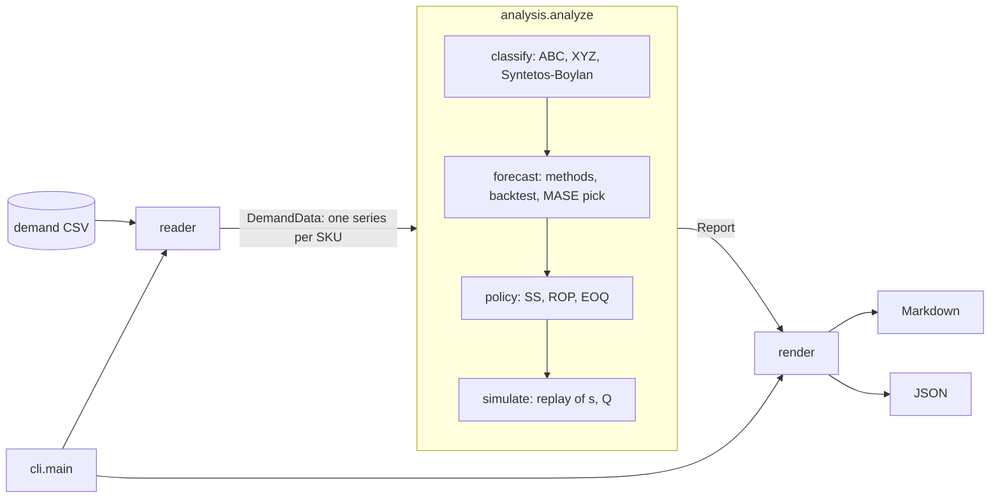

# inventory-policy-lab

[](https://github.com/rodrix91/inventory-policy-lab/actions/workflows/ci.yml)

Turn a CSV of demand history per SKU into an inventory-policy report you can check: ABC-XYZ classes, demand patterns (smooth, erratic, intermittent, lumpy), backtested forecasts, safety stock, reorder point, EOQ, and a replay of the resulting (s, Q) policy on the same history.

Python 3.11+, standard library only at runtime. Library and command line.

**Status: alpha, version 0.1.0.** The methods are textbook methods, implemented and tested carefully, but the tool has not been used on many real datasets yet. Read [Limitations](#limitations) before using its numbers for real orders.

## Why it matters for operations

Most stock problems are policy problems: the same safety-stock rule applied to a fast, stable item and to a spare part that sells twice a year; a forecast chosen because it is the default, not because it was tested; a reorder point computed once and never checked against what would actually have happened. This tool makes each step explicit and reviewable:

- **Segment before you set policy.** ABC (value) and XYZ (variability) tell you where accuracy and service matter most; the Syntetos-Boylan classes tell you which forecasting methods even make sense.
- **Test the forecast on data it has not seen.** Every candidate method is backtested on a holdout and scored with MASE, which works with zero-demand periods (MAPE does not).
- **Verify the policy, not only the formula.** The (s, Q) policy is replayed period by period on the history, reporting the fill rate, stockout periods and average stock it would have produced. When the normal-distribution formula does not fit the item (lumpy demand, seasonality), the replay shows it.

It was written for teaching and analysis in operations management and logistics: every number in the report can be traced to a formula below, and the [worked example](#worked-example-checked-by-hand) is verified by hand in the test suite.

## Install

Not on PyPI. Install from GitHub (or from a clone with `pip install .`):

```bash
python -m pip install "git+https://github.com/rodrix91/inventory-policy-lab@v0.1.0"
inventory-policy-lab --help
```

From a clone you can also run it without installing: `PYTHONPATH=src python -m inventory_policy_lab ...`.

## Quickstart

The repository ships a **synthetic** dataset ([`examples/demand_synthetic.csv`](examples/demand_synthetic.csv)): 12 made-up SKUs over 24 months, generated with a fixed seed by [`scripts/generate_example.py`](scripts/generate_example.py). It is not real company data; it was built to contain each demand pattern, an item introduced late and a month without a row.

```bash
python -m inventory_policy_lab examples/demand_synthetic.csv
```

Output:

````markdown
# Inventory policy report

- Source: `examples/demand_synthetic.csv` (273 rows)
- SKUs: 12; periods: 24 (month), 2024-01 to 2025-12
- ABC by annual consumption value (units x unit cost): A < 80% and B < 95% of cumulative value; XYZ by CV: X <= 0.5, Y <= 1
- Target cycle service level: 95%; review period: 1; holdout: last 6 periods; safety-stock sigma: standard deviation of demand per period
- Replayed fill rate, all SKUs: 99.4%

## ABC-XYZ matrix

|  | X | Y | Z | Total |
|---|---|---|---|---|
| **A** | 5 | 1 | 0 | 6 |
| **B** | 0 | 0 | 2 | 2 |
| **C** | 1 | 0 | 3 | 4 |

## Demand patterns (Syntetos-Boylan)

| Pattern | SKUs |
|---|---|
| smooth | 6 |
| erratic | 1 |
| intermittent | 3 |
| lumpy | 2 |

## Policy per SKU

| SKU | Class | Pattern | Method | Forecast/period | CSL | Safety stock | Reorder point (s) | Order qty (Q) | Fill rate | Stockout periods | Avg on hand |
|---|---|---|---|---|---|---|---|---|---|---|---|
| SKU-001 | AX | smooth | moving_average | 119.7 | 95% | 103.1 | 372.3 | 119.7 (cover) | 100.0% | 0/24 | 190.8 |
| SKU-002 | AX | smooth | naive | 30.0 | 95% | 41.1 | 141.1 | 30.0 (cover) | 100.0% | 0/24 | 42.8 |
| SKU-003 | AX | smooth | naive | 68.0 | 95% | 63.1 | 199.1 | 68.0 (cover) | 98.0% | 3/24 | 76.5 |
| SKU-004 | AX | smooth | naive | 83.0 | 95% | 41.7 | 207.7 | 83.0 (cover) | 100.0% | 0/24 | 141.2 |
| SKU-005 | AY | erratic | naive | 152.0 | 95% | 296.2 | 714.2 | 152.0 (cover) | 100.0% | 0/24 | 555.7 |
| SKU-006 | BZ | intermittent | ses | 2.4 | 95% | 13.2 | 21.3 | 2.4 (cover) | 95.9% | 1/24 | 10.9 |
| SKU-007 | BZ | lumpy | ses | 3.6 | 95% | 40.7 | 57.6 | 3.6 (cover) | 100.0% | 0/24 | 40.6 |
| SKU-008 | CZ | intermittent | sba | 0.4 | 95% | 1.1 | 1.9 | 0.4 (cover) | 99.8% | 1/24 | 1.4 |
| SKU-009 | CX | smooth | ses | 126.0 | 95% | 25.2 | 277.2 | 126.0 (cover) | 100.0% | 0/24 | 113.8 |
| SKU-010 | CZ | intermittent | ses | 0.4 | 95% | 8.4 | 9.5 | 0.4 (cover) | 76.9% | 2/24 | 7.1 |
| SKU-011 | AX | smooth | ses | 40.3 | 95% | 17.0 | 137.9 | 40.3 (cover) | 100.0% | 0/10 | 54.1 |
| SKU-012 | CZ | lumpy | ses | 0.7 | 95% | 26.2 | 27.5 | 0.7 (cover) | 72.5% | 2/24 | 22.6 |

## Forecast backtest (MASE, last 6 periods)

Lower is better; below 1 beats the in-sample naive forecast. Intermittent and lumpy SKUs are scored with SES, Croston and SBA; the others with naive, moving average and SES.

| SKU | naive | moving_average | ses | croston | sba | Bias of pick |
|---|---|---|---|---|---|---|
| SKU-001 | 1.40 | **0.70** | 0.87 | - | - | -0.67 |
| SKU-002 | **0.30** | 0.41 | 0.41 | - | - | 2.67 |
| SKU-003 | **1.00** | 1.99 | 2.06 | - | - | 5.17 |
| SKU-004 | **1.67** | 2.17 | 2.76 | - | - | -2.33 |
| SKU-005 | **0.75** | 1.20 | 1.09 | - | - | -0.83 |
| SKU-006 | - | - | **0.91** | 0.97 | 0.95 | 1.54 |
| SKU-007 | - | - | **3.46** | 4.78 | 4.65 | -2.07 |
| SKU-008 | - | - | 0.83 | 0.85 | **0.83** | 0.24 |
| SKU-009 | 1.84 | 1.26 | **1.23** | - | - | -2.99 |
| SKU-010 | - | - | **0.33** | 0.43 | 0.41 | 1.04 |
| SKU-011 | 1.44 | 1.17 | **0.91** | - | - | -0.01 |
| SKU-012 | - | - | **0.12** | 0.88 | 0.84 | 1.06 |

## Notes

- SKU-002: 1 period(s) without rows counted as zero demand
- SKU-003: no observed lead times: default lead time used
- SKU-008: no observed lead times: default lead time used
- SKU-009: no observed lead times: default lead time used
- SKU-012: no observed lead times: default lead time used

Fill rate, stockout periods and average on hand come from replaying this same history under the (s, Q) policy (in-sample): a check of the formulas on the data, not a forecast of future service.
````

This is the real output of that command; the test suite fails if it drifts from a fresh run (`python scripts/update_readme_samples.py` regenerates it). Add `--format json` for every number, including all backtest metrics, z, sigmas, EOQ and the replay details, or `-o report.md` to write a file.

How to read it: the replayed fill rate is a different measure from the target **cycle** service level (the probability of not running out in a replenishment cycle), so they are not expected to match. In this run every smooth item reaches a fill rate of 98% or more. Two SKUs do not: the lumpy SKU-012 (about 73%) and the intermittent SKU-010 (about 77%). SKU-012's demand is mostly zero with occasional orders of 40 to 90 units, far from the normal distribution the safety-stock formula assumes, and a constant reorder point cannot protect it at 95%. That is the kind of finding the replay is there to surface.

The ABC Pareto of this dataset, drawn as SVG with the standard library by [`scripts/make_pareto_svg.py`](scripts/make_pareto_svg.py) from the same run:


## Input format

One row per SKU and period, long format. Header names are case-insensitive.

| Column | Required | Meaning |
|---|---|---|
| `sku` | yes | Item identifier |
| `period` or `date` | yes | `YYYY-MM`, `YYYY-MM-DD`, or an integer; one format per file |
| `quantity` (`qty`, `demand`) | yes | Demand in the period, a number >= 0 |
| `unit_cost` | no | Cost of one unit; the most recent non-empty value per SKU is used. Needed for ABC by value and for EOQ |
| `lead_time` | no | An observed replenishment lead time in periods. All non-empty values of a SKU are treated as observations (mean and standard deviation) |

- Several rows for the same SKU and period are summed.
- A SKU's series starts at its first period in the file and ends at the file's last period. Periods in between without a row count as zero demand (the report notes how many). For months and integers the calendar is complete; for dates it is the set of dates present, since the frequency cannot be inferred.
- Demand is what customers asked for. Net returns out before the analysis: negative quantities are rejected.

## Worked example (checked by hand)

[`examples/worked_example.csv`](examples/worked_example.csv) has two SKUs over 8 periods. Every number below is derived by hand in the docstring of [`tests/test_worked_example.py`](tests/test_worked_example.py), and the test asserts them. For W-1 (demand 10 12 8 10 14 6 10 14, unit cost 2, lead time 2):

- Moving average wins the holdout with MASE 0.5 (MAE 2 over a naive in-sample scale of 4), so the forecast is mean(6, 10, 14) = 10 per period.
- Safety stock = 1.6449 x sqrt((2 + 1) x 54/7) = 7.91; reorder point = 10 x (2 + 1) + 7.91 = 37.91.
- EOQ = sqrt(2 x 120 x 30 / (0.25 x 2)) = 120.

W-2 (0 0 6 0 0 0 9 0) is intermittent (ADI 4, CV² 0.04); SBA wins with forecast 0.95 x 6.3 / 3.1 = 1.93.

```bash
python -m inventory_policy_lab examples/worked_example.csv --holdout 2 --ordering-cost 30 --holding-rate 0.25
```

Output:

````markdown
# Inventory policy report

- Source: `examples/worked_example.csv` (16 rows)
- SKUs: 2; periods: 8 (integer), 1 to 8
- ABC by annual consumption value (units x unit cost): A < 80% and B < 95% of cumulative value; XYZ by CV: X <= 0.5, Y <= 1
- Target cycle service level: 95%; review period: 1; holdout: last 2 periods; safety-stock sigma: standard deviation of demand per period
- Replayed fill rate, all SKUs: 100.0%

## ABC-XYZ matrix

|  | X | Y | Z | Total |
|---|---|---|---|---|
| **A** | 1 | 0 | 0 | 1 |
| **B** | 0 | 0 | 1 | 1 |
| **C** | 0 | 0 | 0 | 0 |

## Demand patterns (Syntetos-Boylan)

| Pattern | SKUs |
|---|---|
| smooth | 1 |
| erratic | 0 |
| intermittent | 1 |
| lumpy | 0 |

## Policy per SKU

| SKU | Class | Pattern | Method | Forecast/period | CSL | Safety stock | Reorder point (s) | Order qty (Q) | Fill rate | Stockout periods | Avg on hand |
|---|---|---|---|---|---|---|---|---|---|---|---|
| W-1 | AX | smooth | moving_average | 10.0 | 95% | 7.9 | 37.9 | 120.0 (eoq) | 100.0% | 0/8 | 111.7 |
| W-2 | BZ | intermittent | sba | 1.9 | 95% | 8.3 | 12.1 | 74.6 (eoq) | 100.0% | 0/8 | 80.0 |

## Forecast backtest (MASE, last 2 periods)

Lower is better; below 1 beats the in-sample naive forecast. Intermittent and lumpy SKUs are scored with SES, Croston and SBA; the others with naive, moving average and SES.

| SKU | naive | moving_average | ses | croston | sba | Bias of pick |
|---|---|---|---|---|---|---|
| W-1 | 1.00 | **0.50** | 0.55 | - | - | -2.00 |
| W-2 | - | - | 2.22 | 1.88 | **1.88** | -2.58 |

## Notes

- W-2: no observed lead times: default lead time used

Fill rate, stockout periods and average on hand come from replaying this same history under the (s, Q) policy (in-sample): a check of the formulas on the data, not a forecast of future service.
````

## Python API

```python
from inventory_policy_lab import Config, analyze_file, render_markdown

config = Config(class_service_levels={"A": 0.98}, ordering_cost=40, holding_rate=0.25)
report = analyze_file("examples/demand_synthetic.csv", config)
for sku in report.skus:
    print(sku.sku, sku.abc_xyz, sku.method, sku.policy.reorder_point, sku.simulation.fill_rate)
markdown = render_markdown(report)  # or render_json(report) / report.to_dict()
```

The building blocks are public too: `read_demand`, `abc_classes`, `xyz_class`, `demand_profile`, `naive`, `moving_average`, `ses`, `croston`, `sba`, `backtest`, `safety_stock`, `eoq`, `build_policy` and `simulate`. Errors are subclasses of `InventoryPolicyError` with an `exit_code`.

## Options

| Option | Default | Meaning |
|---|---|---|
| `--format markdown\|json` | markdown | Output format |
| `-o, --output FILE` | stdout | Write the report to a file |
| `--service-level P` | 0.95 | Target cycle service level, 0.5 <= P < 1 |
| `--class-service-levels A=0.99,B=0.95,C=0.9` | none | Service level per ABC class |
| `--lead-time L`, `--lead-time-std S` | 1, 0 | Lead time (periods) for SKUs without `lead_time` values |
| `--review-period R` | 1 | Periods between reviews, added to the protection interval; 0 = continuous review |
| `--ordering-cost S`, `--holding-rate h` | none | Cost per order and yearly holding cost as a fraction of unit cost; together they enable EOQ |
| `--order-cover K` | 1 | Without EOQ, order quantity = forecast x K periods |
| `--sigma demand\|rmse` | demand | Safety-stock sigma: standard deviation of demand per period, or RMSE of the picked forecast on the holdout |
| `--abc-thresholds a,b` | 0.8,0.95 | Cumulative value shares that end classes A and B |
| `--xyz-thresholds x,y` | 0.5,1.0 | CV limits of X and Y |
| `--periods-per-year N` | 12 | To annualize demand (52 for weeks) |
| `--holdout H` | 6 | Periods held out for the backtest |
| `--ma-window W`, `--ses-alpha a`, `--croston-alpha a` | 3, 0.2, 0.1 | Method parameters |

Exit codes: `0` report written, `2` invalid option or value, `3` input file missing, unreadable or not UTF-8 (or output not writable), `4` invalid data, `5` history too short for the holdout (needs at least holdout + 2 periods).

## Methods

All demand quantities are per period; lead times are in periods.

**ABC.** Annual consumption value = mean demand per period x periods per year x unit cost (annual units when there is no `unit_cost` column). Items are sorted by value; an item is A while the cumulative share of the items *before* it is below 80%, B while it is below 95%, C after that. Testing the share before the item keeps the largest item in A even when it alone exceeds 80%.

**XYZ.** `CV = population standard deviation / mean` of demand per period: X if CV <= 0.5, Y if CV <= 1.0, else Z (also Z when there is no demand). Cut-offs vary in practice; both sets of thresholds are options.

**Demand pattern** (Syntetos, Boylan & Croston, 2005). `ADI = periods / periods with demand`; `CV² = (population sd / mean)²` of the non-zero demand sizes. Smooth: ADI < 1.32 and CV² < 0.49; erratic: ADI < 1.32 and CV² >= 0.49; intermittent: ADI >= 1.32 and CV² < 0.49; lumpy: both above.

**Forecasts** (one step ahead):

```
naive:            F(t+1) = y(t)
moving average:   F(t+1) = mean(y(t-W+1) .. y(t))
SES:              L(t) = L(t-1) + a (y(t) - L(t-1)),  L(1) = y(1),  F(t+1) = L(t)
Croston:          size z and interval p smoothed only when demand occurs,
                  starting at the first demand; F = z / p
SBA:              F = (1 - a/2) z / p          (Syntetos & Boylan, 2005)
```

Smooth and erratic SKUs are scored with naive, moving average and SES; intermittent and lumpy SKUs with SES, Croston and SBA. Naive and moving averages are left out on mostly-zero series because after a run of zeros they forecast zero, which scores well on error measures yet means holding no stock (Teunter & Duncan, 2009); see [ADR 0002](docs/decisions/0002-forecast-selection.md).

**Backtest and selection.** For each of the last H periods, the method is fitted on the periods before it and forecasts that period (rolling origin). With errors `e = forecast - actual`:

```
MAE  = mean |e|          RMSE = sqrt(mean e²)          bias = mean e   (positive = over-forecast)
MASE = MAE / mean |y(i) - y(i-1)| over the training periods       (Hyndman & Koehler, 2006)
```

The method with the lowest MASE is used (ties go to the earlier method in the list above). MASE is undefined when the training data is constant; then MAE decides. MAPE is not used because it divides by actual demand, which is often zero. SKUs shorter than H + 2 periods are not backtested; they use a moving average (SES if intermittent) and the report says so.

**Safety stock and reorder point** (Silver, Pyke & Thomas, 2017), for a target cycle service level P:

```
z  = NormalDist().inv_cdf(P)
SS = z x sqrt((L + R) x sigma_D² + D² x sigma_L²)
s  = D x (L + R) + SS
```

`D` is the forecast per period, `sigma_D` the sample standard deviation of demand per period (or the holdout RMSE with `--sigma rmse`), `L` and `sigma_L` the mean and sample standard deviation of the observed lead times (or the defaults), and `R` the review period. Demand is reviewed once per period in the data, so `R = 1` by default: an order placed now must cover demand until the next order can arrive, `L + R` periods later. `R = 0` gives the continuous-review textbook formula. See [ADR 0003](docs/decisions/0003-policy-and-replay.md).

**EOQ.** `Q* = sqrt(2 x A x S / H)` with `A = D x periods per year`, `S` the cost per order and `H = holding rate x unit cost`. Without EOQ settings, `Q = D x order cover`; with a zero forecast, Q = 1 unit so the replay can run (noted in the report).

**Replay.** Starting with `s + Q` on hand: orders due arrive at the start of each period; demand is served from stock and the rest is backordered; at the end of the period, while the inventory position (net stock + on order) is at or below `s`, an order of `Q` is placed, arriving at the start of period `t + L + 1` (L rounded half up to whole periods). Fill rate = units served from stock when demanded / total demand; a stockout period is one whose demand was not fully served from stock; average on hand is the mean end-of-period stock.

## Architecture



Data flows one way: `reader` returns plain data, `analysis` returns a `Report`, renderers only format it. Errors are exceptions with an exit code; only `cli.main` prints them. See [ADR 0001](docs/decisions/0001-architecture.md).

## Limitations

- **Normal approximation.** Safety stock assumes independent, normally distributed demand per period and lead time. It fits poorly for lumpy and slow-moving items; the replay exposes the gap but the tool does not offer a compound-Poisson or bootstrap alternative yet.
- **Stationary methods.** No trend or seasonal models (Holt, Holt-Winters). A seasonal or trending item gets a level forecast and a sigma inflated by the pattern.
- **One policy for the whole history.** The replay applies the reorder point computed from the end of the history to all of it, so it is in-sample: a check of the policy on the data, not an out-of-sample estimate of future service.
- **Selection by a per-period error measure.** MASE is the best-behaved of the usual accuracy measures on zeros, but Teunter & Duncan (2009) show that per-period error measures are a poor guide for intermittent items, where service and stock outcomes matter more. On intermittent and lumpy SKUs the pick among SES, Croston and SBA is a heuristic; the replay is the better judge.
- **Cycle service level only.** The target is the probability of no stockout per cycle; a fill-rate target (expected units short, the loss function) is not solved for, only measured by the replay.
- **Lead time in whole periods in the replay**, rounded half up; no partial deliveries, order minimums, pack sizes or capacity limits.
- **No demand cleaning.** Stockout-censored history, promotions and outliers are used as they are. Negative quantities are rejected rather than netted.
- Files are read whole into memory; fine for thousands of SKUs, not designed for millions of rows.

## Development

See [CONTRIBUTING.md](CONTRIBUTING.md). In short: `python -m pytest`, `coverage run -m pytest && coverage combine && coverage report` (100% line and branch coverage is enforced), `ruff check .`, `ruff format --check .`, `mypy` (strict). Design decisions are recorded in [docs/decisions](docs/decisions). Changes are listed in the [CHANGELOG](CHANGELOG.md).

## References

- Silver, E. A., Pyke, D. F., & Thomas, D. J. (2017). *Inventory and Production Management in Supply Chains* (4th ed.). CRC Press.
- Croston, J. D. (1972). Forecasting and stock control for intermittent demands. *Operational Research Quarterly*, 23(3), 289-303.
- Syntetos, A. A., & Boylan, J. E. (2005). The accuracy of intermittent demand estimates. *International Journal of Forecasting*, 21(2), 303-314.
- Syntetos, A. A., Boylan, J. E., & Croston, J. D. (2005). On the categorization of demand patterns. *Journal of the Operational Research Society*, 56(5), 495-503.
- Hyndman, R. J., & Koehler, A. B. (2006). Another look at measures of forecast accuracy. *International Journal of Forecasting*, 22(4), 679-688.
- Teunter, R. H., & Duncan, L. (2009). Forecasting intermittent demand: a comparative study. *Journal of the Operational Research Society*, 60(3), 321-329.

## License

MIT, see [LICENSE](LICENSE). Copyright (c) 2026 Rodrigo Pantoja Navajas.
